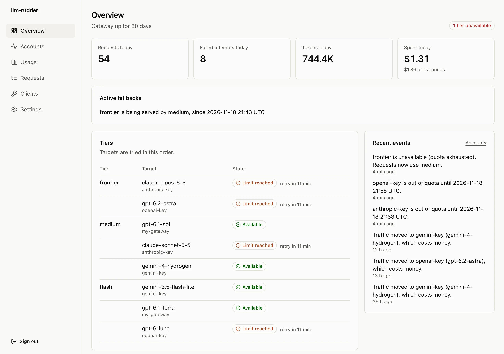
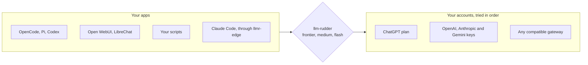
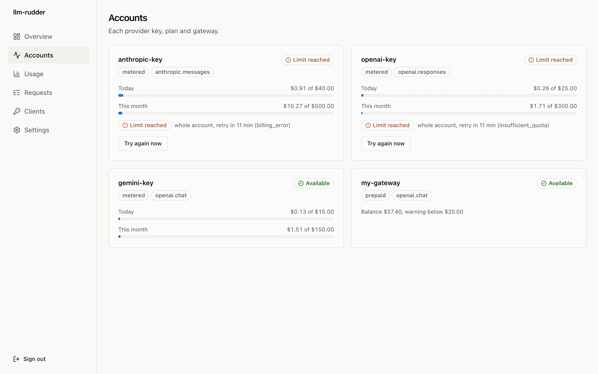
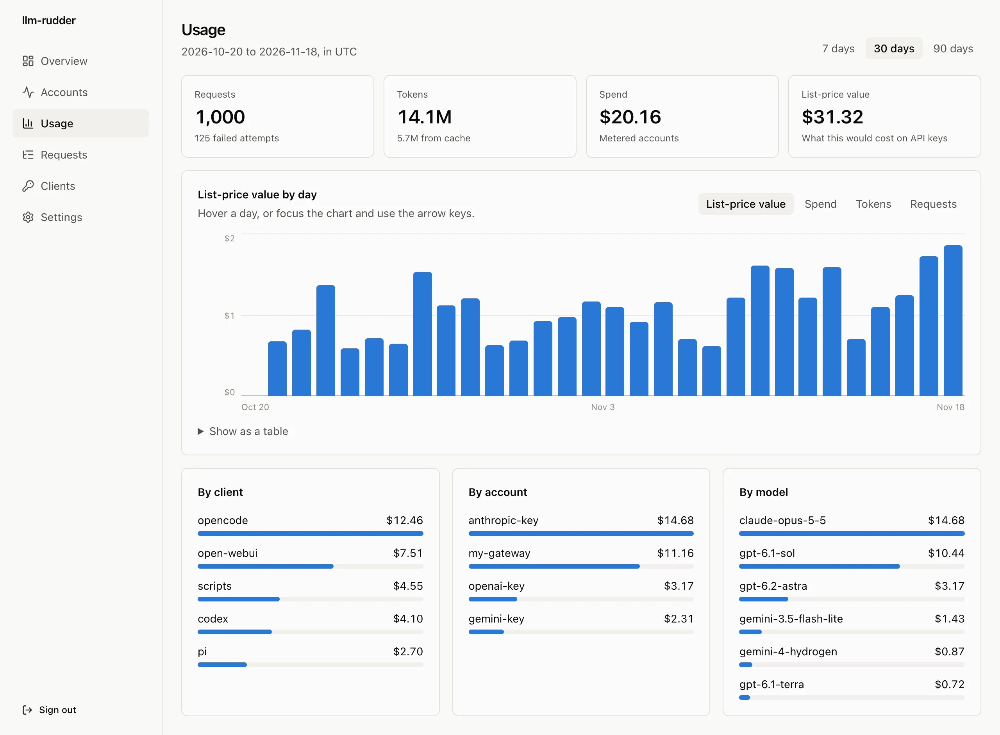
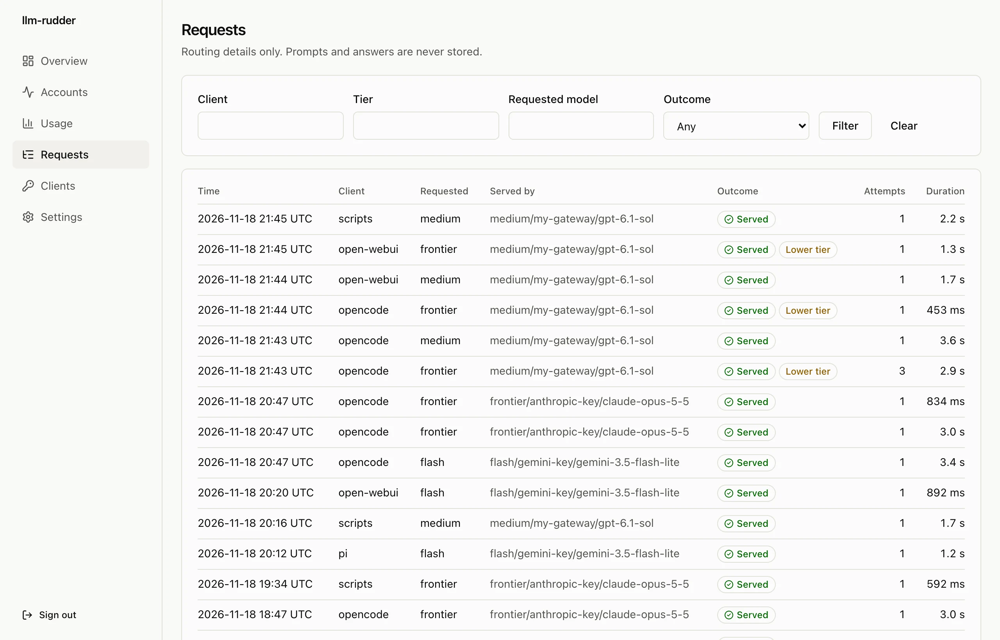
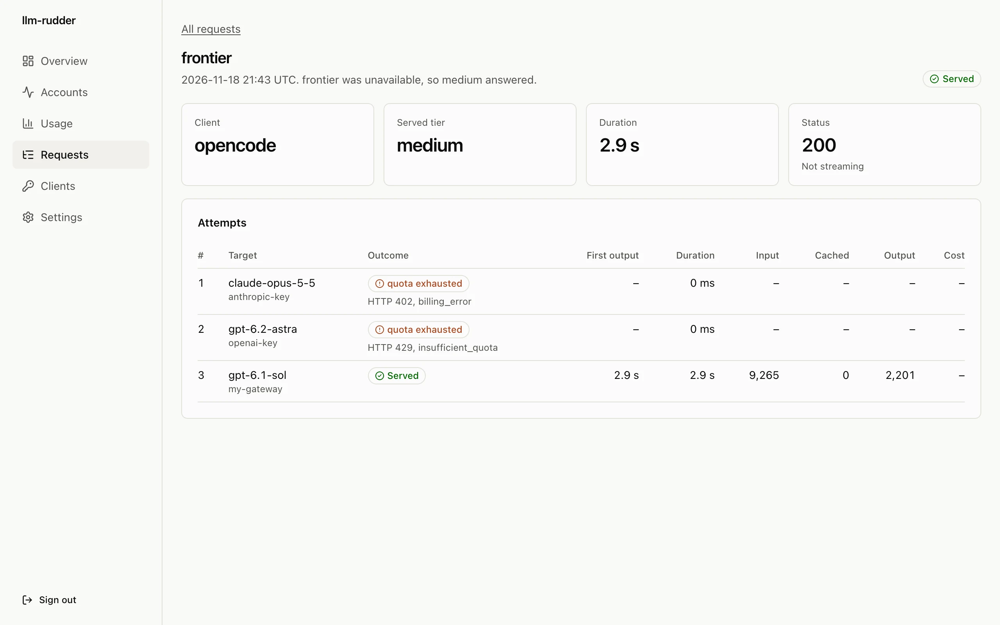
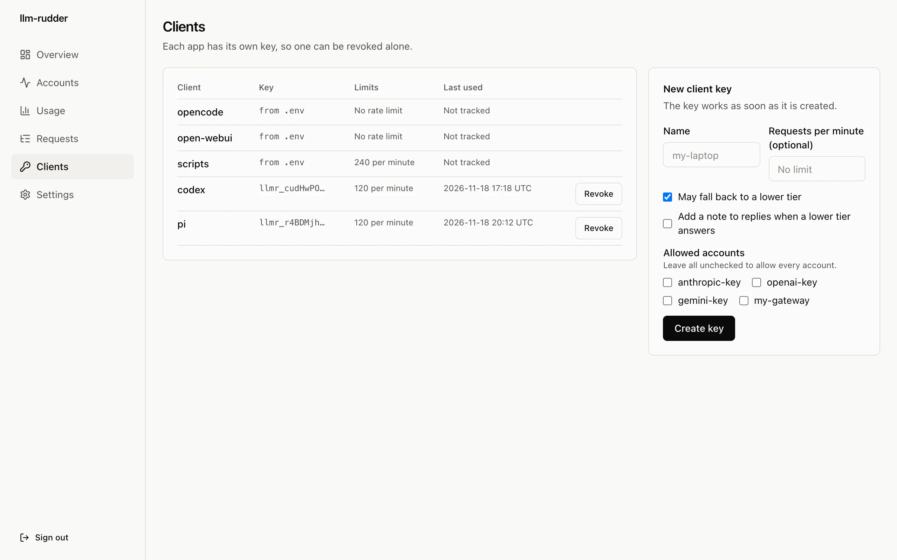
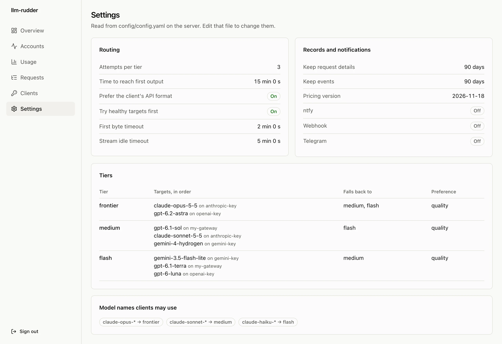

# llm-rudder

**One endpoint for all your AI plans, API keys and gateways. When one runs out, your work keeps going.**

Point your coding agents, chat apps and scripts at llm-rudder and ask for `frontier`, `medium` or `flash`. It picks a real model from the accounts you already have, moves to the next one when a provider fails or runs out of quota, and drops to a lower tier with a visible warning instead of failing your task.

<picture>
  <source media="(prefers-color-scheme: dark)" srcset="docs/images/overview-dark.webp">
  
</picture>

<sub>The dashboard during an incident, using made-up demo data: both frontier accounts ran out, so requests moved to `medium`.</sub>

## What it does

- **One name for each quality level.** Apps ask for a tier. You decide in one file which models serve it, and you can change them without touching any app.
- **Automatic failover.** Errors, rate limits and used-up quotas move the request to the next model before any output reaches your app.
- **A warning instead of a failure.** When a whole tier is out, requests use the next tier and the reply says so.
- **Any app, any model.** It speaks the OpenAI Chat Completions, OpenAI Responses and Anthropic Messages APIs, and translates between them.
- **Your plans and keys together.** Use API keys, an eligible ChatGPT plan, your Claude plan through a small local helper, and any compatible service such as New API, LiteLLM, sub2api or OpenRouter.
- **A clear view of what happened.** The dashboard shows accounts, spending, usage and every routing decision. Budgets cap paid keys. Prompts and answers are never stored.



## See it in two minutes

You need [Node.js](https://nodejs.org) 22.19 or later. The demos use fake providers, so they need no accounts, keys or database.

```bash
git clone https://github.com/ruobin/llm-rudder.git
cd llm-rudder
npm install --global pnpm   # skip this if you already have pnpm
pnpm install

pnpm demo             # routing, failover, a tier drop and recovery, in your terminal
pnpm demo:dashboard   # the web dashboard, with a month of made-up traffic
```

For the dashboard, open <http://127.0.0.1:4150> and sign in with the password `demo-password`.

## A look at the dashboard

<table>
<tr>
<td width="50%" valign="top">
<a href="docs/USER_GUIDE.md#accounts"><strong>Accounts</strong></a><br>
Limits, budgets and balances for each key, plan and gateway.<br><br>
<picture>
  <source media="(prefers-color-scheme: dark)" srcset="docs/images/accounts-dark.webp">
  
</picture>
</td>
<td width="50%" valign="top">
<a href="docs/USER_GUIDE.md#usage"><strong>Usage</strong></a><br>
Tokens, spending and value by day, app, account and model.<br><br>
<picture>
  <source media="(prefers-color-scheme: dark)" srcset="docs/images/usage-dark.webp">
  
</picture>
</td>
</tr>
<tr>
<td width="50%" valign="top">
<a href="docs/USER_GUIDE.md#requests"><strong>Requests</strong></a><br>
Every routing decision, with lower-tier answers marked.<br><br>
<picture>
  <source media="(prefers-color-scheme: dark)" srcset="docs/images/requests-dark.webp">
  
</picture>
</td>
<td width="50%" valign="top">
<a href="docs/USER_GUIDE.md#request-details"><strong>Request details</strong></a><br>
Each target that was tried, and why it failed or answered.<br><br>
<picture>
  <source media="(prefers-color-scheme: dark)" srcset="docs/images/request-detail-dark.webp">
  
</picture>
</td>
</tr>
<tr>
<td width="50%" valign="top">
<a href="docs/USER_GUIDE.md#clients"><strong>Clients</strong></a><br>
A separate key for each app, which you can revoke on its own.<br><br>
<picture>
  <source media="(prefers-color-scheme: dark)" srcset="docs/images/clients-dark.webp">
  
</picture>
</td>
<td width="50%" valign="top">
<a href="docs/USER_GUIDE.md#settings"><strong>Settings</strong></a><br>
The tiers and routing rules your gateway is using.<br><br>
<picture>
  <source media="(prefers-color-scheme: dark)" srcset="docs/images/settings-dark.webp">
  
</picture>
</td>
</tr>
</table>

## Set it up

You need a Linux server with Docker, Git and OpenSSL, in a region your providers support, such as the United States, Singapore or Taiwan. Hong Kong and mainland China are not supported by Anthropic, OpenAI or Google.

**1. Install it and create its secrets.**

```bash
git clone https://github.com/ruobin/llm-rudder.git /opt/llm-rudder
cd /opt/llm-rudder

cp .env.example .env
chmod 600 .env
sed -i "s/^MYSQL_PASSWORD=.*/MYSQL_PASSWORD=$(openssl rand -hex 24)/" .env
sed -i "s/^MYSQL_ROOT_PASSWORD=.*/MYSQL_ROOT_PASSWORD=$(openssl rand -hex 24)/" .env
cp config/config.example.yaml config/config.yaml

docker compose build gateway

sed -i '/^LLMR_ADMIN_KEY=$/d; /^LLMR_KEY_[A-Z_]*=$/d' .env
docker compose run --rm -T --no-deps gateway node dist/cli.js keygen \
  LLMR_ADMIN_KEY LLMR_KEY_OPENCODE LLMR_KEY_PI LLMR_KEY_CHAT_UI \
  LLMR_KEY_SCRIPTS LLMR_KEY_CLAUDE_CODE LLMR_KEY_CODEX >> .env
```

**2. Add your accounts.** Put your provider keys in `.env`. In `config/config.yaml`, delete the accounts you do not use and their lines under `tiers`. The [user guide](docs/USER_GUIDE.md#set-up-your-accounts) has a recipe for each kind of account.

**3. Start it and check every account.** The last command sends two short real requests to each model, so you find a wrong key or model name now and not during a task.

```bash
docker compose run --rm --no-deps gateway node dist/cli.js check-config
docker compose up -d gateway
docker compose exec gateway node dist/cli.js check-accounts --live
```

**4. Send your first request.**

```bash
set -a; . ./.env; set +a
curl -i http://127.0.0.1:4141/v1/chat/completions \
  -H "Authorization: Bearer $LLMR_KEY_SCRIPTS" \
  -H "Content-Type: application/json" \
  -d '{"model":"medium","messages":[{"role":"user","content":"Hello"}]}'
```

The `x-llmr-target` response header shows which tier, account and model answered.

**5. Make it reachable.** It listens only on the server itself. The [deployment guide](docs/DEPLOYMENT.md#4-let-your-clients-reach-it) shows how to publish it with Caddy, Nginx or Tailscale, and how to add the [dashboard](docs/DEPLOYMENT.md#10-add-the-dashboard), [alerts](docs/DEPLOYMENT.md#11-get-alerts) and [backups](docs/DEPLOYMENT.md#8-what-to-back-up).

## Connect your apps

Each app uses your gateway's address followed by `/v1`, its own key, and `frontier`, `medium` or `flash` as the model.

| App                              | How to connect it                                                                    |
| -------------------------------- | ------------------------------------------------------------------------------------ |
| Any OpenAI-compatible app or SDK | [Set the base URL and key](docs/USER_GUIDE.md#any-openai-compatible-app)             |
| OpenCode                         | [Provider settings](docs/DESIGN.md#opencode-phase-1)                                 |
| Pi                               | [Model settings](docs/DESIGN.md#pi-phase-1)                                          |
| Open WebUI                       | [Connection settings](docs/DESIGN.md#open-webui-phase-1)                             |
| LibreChat                        | [Endpoint settings](docs/DESIGN.md#librechat-phase-1)                                |
| Claude Code                      | [Keep your Claude plan, with a fallback](docs/USER_GUIDE.md#use-it-with-claude-code) |
| Codex                            | [A profile for llm-rudder](docs/USER_GUIDE.md#use-it-with-codex)                     |

## Documentation

| Read this                              | To learn                                                                     |
| -------------------------------------- | ---------------------------------------------------------------------------- |
| [User guide](docs/USER_GUIDE.md)       | How routing works, setting up accounts, connecting apps, using the dashboard |
| [Deployment guide](docs/DEPLOYMENT.md) | Running it on a server: access, updates, alerts, metrics and backups         |
| [Design](docs/DESIGN.md)               | The architecture and the reasons behind it                                   |
| [To-do list](docs/TODO.md)             | What is finished, and what still needs real-world testing                    |
| [Contributing](CONTRIBUTING.md)        | A tour of the code, and how to change and test it                            |

## Project status

Phases 1 to 5 are built, including the dashboard, metrics, alerts and encrypted backups. From Phase 6, [several instances](docs/DEPLOYMENT.md#14-run-several-instances) can share the work, with updates that do not interrupt requests. A deployed gateway has served real requests through a ChatGPT plan and through a New API gateway, including tool calls in all three API formats. The real OpenCode, Pi, Claude Code and Codex command-line clients are tested automatically against fake providers. Direct OpenAI, Anthropic and Gemini API keys, and those clients on real accounts, still need testing. The [to-do list](docs/TODO.md) has the details.

## Develop

```bash
pnpm dev                 # run the gateway with reload; needs config/config.yaml
pnpm check               # lint, format check, type-check and tests
pnpm smoke:claude-code   # run the real Claude Code CLI with a fake login and no outside network
pnpm smoke:codex         # the same for Codex
pnpm smoke:clients       # the same for OpenCode and Pi
pnpm load-test           # measure added latency, stream memory and throughput
pnpm docs:screenshots    # retake the screenshots in docs/images; needs Google Chrome
```

Tests use fake upstreams and recorded responses. To include the MySQL and Redis tests, set `TEST_DATABASE_URL` and `TEST_REDIS_URL`.

## License

MIT. See [LICENSE](LICENSE).
