# llm-rudder — Design

|            |                                                                                                                                  |
| ---------- | -------------------------------------------------------------------------------------------------------------------------------- |
| Status     | Draft 2, updated 2026-11-18 with Phases 1 to 5 as built. It replaces the local-first Python Draft 1, which stays in git history. |
| Scope      | A personal model gateway on your own VPS, with a phased path to a production-grade service                                       |
| Deployment | [`DEPLOYMENT.md`](DEPLOYMENT.md) has the tested steps for installing and operating it.                                           |
| Work plan  | [`TODO.md`](TODO.md) splits the work into phases with checklists and exit criteria.                                              |

**In one sentence:** llm-rudder is one HTTPS endpoint on your VPS that turns `frontier`, `medium` and `flash` into real models across your subscriptions, API keys and third-party gateways, moves to the next option when one runs out, and warns you when it has to drop to a lower tier.

## Contents

1. [Summary](#1-summary)
2. [Goals, non-goals and assumptions](#2-goals-non-goals-and-assumptions)
3. [Ground rules from the providers](#3-ground-rules-from-the-providers)
4. [Concepts](#4-concepts)
5. [Architecture](#5-architecture)
6. [Request lifecycle](#6-request-lifecycle)
7. [Client integration](#7-client-integration)
8. [Low-level design](#8-low-level-design)
9. [Deployment](#9-deployment)
10. [Scaling plan](#10-scaling-plan)
11. [Delivery phases](#11-delivery-phases)
12. [Decisions and trade-offs](#12-decisions-and-trade-offs)
13. [Risks and open questions](#13-risks-and-open-questions)

Appendices: [A. Client setup](#appendix-a-client-setup) · [B. What changed](#appendix-b-what-changed) · [C. Sources](#appendix-c-sources)

---

## 1. Summary

You pay for several kinds of model access: Claude, ChatGPT and Gemini plans, API keys for all three, and third-party gateways such as your own New API instance. You also use many clients: OpenCode, Pi, Claude Code, Codex, a chat UI, and your own scripts. Today each client is tied to one kind of access, and when that runs out the work stops.

llm-rudder puts one endpoint in front of all of it:

- A client asks for a **tier**: `frontier`, `medium` or `flash`.
- Each tier is an **ordered list of targets**. A target is one model on one account, such as "GPT-6 Astra on my OpenAI key".
- When a target runs out of quota, hits a rate limit or fails, the router answers the same request from the next target. The client sees a normal response.
- When every target in a tier is used up, the router **falls back to the next tier** and **warns you**. A task does not fail just because `frontier` ran out.

### What each kind of access can do

These are the conclusions from section 3. They shape the whole design.

| You have                                               | Usable through the router?       | How                                                                                                                                                      |
| ------------------------------------------------------ | -------------------------------- | -------------------------------------------------------------------------------------------------------------------------------------------------------- |
| **API keys** (Anthropic, OpenAI, Gemini)               | Yes, from every client           | Normal metered use on the VPS.                                                                                                                           |
| **Third-party gateways** (your New API, OpenRouter, …) | Yes, from every client           | A first-class OpenAI-compatible account type.                                                                                                            |
| **ChatGPT plan**                                       | Yes, from every client (Phase 4) | OpenAI's Sign in with ChatGPT, which documents running an **open-source** app on a remote VM. This repository must be public by then.                    |
| **Claude plan**                                        | **Claude Code only** (Phase 2)   | A small local helper, `llmr-edge`, keeps your login on your laptop and sends it only to Anthropic. The VPS never sees it.                                |
| **Gemini plan login**                                  | **No**                           | Google says third-party access through that login can get the account suspended or terminated.                                                           |
| **Gemini plan's monthly developer credit**             | Yes                              | The plan includes $10, $40 or $100 a month of developer credit that Google says can pay for the Gemini API. The router uses it through a normal API key. |

### Five design choices

1. **The gateway runs on the VPS; login tokens that must stay local stay local.** Only Claude Code's plan traffic needs a local helper.
2. **OpenAI Chat Completions first.** OpenCode, Pi, chat UIs and scripts all speak it, so one ingress and one egress adapter cover most clients in Phase 1.
3. **Tier fallback is automatic and visible.** It shows up in response headers, as a one-line note in the reply for clients that opt in, and as a push notification.
4. **Quota is state, not just a retry.** "This account is exhausted until 15:45" is stored and survives restarts, so the router does not keep hitting a dead target.
5. **Popular, boring technology.** TypeScript, Node.js, Fastify, MySQL, Docker, and later Next.js and Redis.

### Build or reuse?

Your New API instance already pools API keys and retries across channels, so this project should not rebuild that. LiteLLM also covers API-key failover. llm-rudder sits **in front of** them and adds what they do not do together: named tiers with fallback and warnings, subscription quota as state, per-client behavior, and a compliant path for each subscription. New API then becomes one good target among several.

---

## 2. Goals, non-goals and assumptions

### Goals

| ID  | Goal                                                                                           |
| --- | ---------------------------------------------------------------------------------------------- |
| G1  | One HTTPS endpoint on the VPS. Clients choose `frontier`, `medium` or `flash`.                 |
| G2  | Automatic failover between targets on quota exhaustion, rate limits, overload and outages.     |
| G3  | Automatic fallback to another tier when a tier is used up, always with a warning.              |
| G4  | Use prepaid capacity first, and never spend more than a configured budget on metered accounts. |
| G5  | Work with OpenCode, Pi, Claude Code, Codex, chat UIs and your own scripts.                     |
| G6  | Support any OpenAI-compatible third-party gateway as an upstream.                              |
| G7  | Be safe to expose on the internet: TLS, per-client keys, spend limits and no prompt logging.   |
| G8  | Show what served each request, what it cost, and the state of every account.                   |
| G9  | Stay within each provider's rules for subscription credentials.                                |

### Non-goals until the last phase

- **Serving other people from your subscriptions.** Plans are personal.
- Hosting models, fine-tuning, and image, audio or embedding endpoints.
- **Choosing a tier from prompt difficulty.** The client chooses. No classifier runs in the request path.
- **The full OpenAI and Anthropic API surface.** The router supports a documented subset.

### Assumptions

- One user, several client machines, one VPS.
- The VPS is in a region every provider supports (section 3.5).
- You have a domain name for the gateway, or you put it behind a private network such as Tailscale.

---

## 3. Ground rules from the providers

This section reflects provider documentation read on 2026-11-18 ([Appendix C](#appendix-c-sources)). These rules changed several times in 2026, so **re-check them before each phase that touches a subscription**. This is an engineering reading of public pages, not legal advice.

### 3.1 Claude plan

Re-read on 2026-11-18, before Phase 2 was built.

- With only `ANTHROPIC_BASE_URL` set, Claude Code keeps your claude.ai login, and `Authorization` carries the login token. A gateway passing that traffic to Anthropic "must forward `Authorization` and the OAuth capability in `anthropic-beta`".
- Setting `ANTHROPIC_AUTH_TOKEN`, `ANTHROPIC_API_KEY` or `apiKeyHelper` **replaces** the subscription login.
- The legal page says developers "may not collect, store, or intermediate Claude.ai credentials or session tokens", and that third-party developers may not "route requests through Free, Pro, Max, or Ultra plan credentials on behalf of their users". OAuth is meant for "ordinary use of Claude Code and other native Anthropic applications". The page also says it does not prevent "an end user from signing in to the unmodified Claude Code binary with their own Claude subscription", and that Anthropic may enforce its rules "without prior notice". The docs do not reconcile this with the gateway instructions, and they say nothing about a single-user gateway.
- Claude Code reads `anthropic-ratelimit-unified-*` headers to show plan usage and "on a `429` to tell a plan limit or spend cap from a temporary throttle". They appear on ordinary responses too, so their presence alone does not mean a limit. Anthropic does not document each name and value.

**What the design does.** The most conservative setup that still gives automatic failover is a local helper. Claude Code talks to `llmr-edge` on `127.0.0.1`. The edge forwards the request unchanged to `api.anthropic.com`, from your own network, with your own login. Only when Anthropic reports a plan limit does the edge send the request to the VPS, **with the Claude token removed**. No Claude credential reaches the VPS, no other client can use the Claude plan, and Claude Code itself stays unmodified.

The tension in Anthropic's wording remains even for a local helper. If you want no router in that path at all, use the fallback in [Appendix A](#appendix-a-client-setup): run Claude Code directly, and switch to gateway mode by hand when the plan runs out.

### 3.2 ChatGPT plan

- OpenAI's route is for "open-source and locally hosted apps". Its VM guide covers this case: "when you run an open-source app on a remote virtual machine".
- Sign-in uses a loopback callback on `127.0.0.1`, which "reaches the computer running the browser, not the remote VM". There is no documented device-code flow. So you sign in on your laptop and transfer the protected credential file over SSH. The VM keeps its own host ID and "owns" later refreshes.
- Access tokens last one hour. Refresh tokens last 30 days and rotate on every refresh, so refreshes must be serialized.
- Inference is `POST https://api.openai.com/v1/responses` with `store: false` and `stream: true`. Many fields and built-in tools are rejected. Function and custom tools must be grouped in namespaces or sent as `additional_tools` items. Web search depends on the model and account.
- A usage limit is `429 subscription_sharing_usage_limit_exceeded`, with **no reset time**. It can also arrive mid-stream as `response.failed`.
- The docs do **not** address a server that forwards other clients' requests with your token, or who may reach that server over the network. The design keeps it strictly single-user and treats this as an open risk.

**What the design does.** The `chatgpt-plan` account is built and off by default ([section 8.13](#813-passthrough-and-translation)). Turn it on only in a public, open-source copy of this project, for your own use.

### 3.3 Gemini plan

- Antigravity FAQ: "Using third-party software, tools, or services to access Antigravity is a violation of our Terms of Service", and it "can result in suspension or termination of your account". OpenCode is named. Gemini CLI's terms make the same point for the services behind it.
- Google recommends "a Gemini Enterprise or Google AI Studio API key" for third-party coding agents.
- Google AI plans include monthly developer credits: **$10 (AI Pro), $40 (Ultra 5x), $100 (Ultra 20x)**. Google's benefits page lists the Gemini API as eligible. The credit applies to a Cloud Billing account, and a Prepay account must first buy at least $5 of credit. Unused credit expires after a year.

**What the design does.** The router never touches a Google login. It uses a Gemini API key, and the key's project is linked to the billing account that receives the credit. No single Google page states that whole chain, so Phase 0 confirms the credit is actually drawn down.

### 3.4 API keys and third-party gateways

Normal use by the key owner. A third-party gateway sees your prompts, so it is treated as a separate trust level (section 8.10). **Subscription tokens are never sent to one**; config validation enforces this.

### 3.5 Where the VPS may run

Anthropic, OpenAI and Google all list the **United States, Singapore and Taiwan**. **Hong Kong and mainland China are absent from all three lists.** OpenAI says use from unsupported locations "may result in your account being blocked or suspended". So the gateway must run in a supported region. Pick the supported region closest to you.

### 3.6 Ruled out

- Reading another tool's login files (`~/.codex/auth.json`, Claude's or Google's credentials).
- Storing a Claude login token on the VPS, or copying `claude setup-token` output there.
- Using a Google AI plan login from the router.
- Pretending to be Claude Code, Codex or any other client.
- Wrapping `claude -p`, `codex exec` or `agy -p` as a model backend for other clients.

If a provider changes its rules, one account stops (`enabled: false`) and the rest keeps working.

### 3.7 API formats and clients

Re-read on 2026-11-18, before Phase 3 was built.

- **Current GPT models call tools only through the Responses API.** OpenAI says GPT-6.2 Astra and Sol support Chat Completions, but that tool calling requires Responses. Its reasoning guide says the same of GPT-6 Astra and GPT-6.1 Sol. So the `openai-key` account uses `api: openai.responses`.
- **Those models also reject some settings.** OpenAI's guide says to omit `temperature` and `top_p` for GPT-6.2 Astra and Sol. The per-model rules live in `config/models.yaml`.
- **Codex needs `POST /v1/responses` and a stream that ends with `response.completed`.** Its gateway guide says replayed input and the IDs linking tool calls to results must be kept, and failure events must be forwarded. Its source shows that a custom provider compacts locally by default, so no compaction endpoint is needed.
- **A Codex catalog entry must include instructions.** Codex rejects an entry that has neither `base_instructions` nor `model_messages.instructions_template`.
- **Anthropic does not support Claude Code on other models.** Its gateway page says Anthropic "doesn't support routing Claude Code to non-Claude models through any gateway". The translator works with today's client, but a Claude Code update could change what it needs, so the canary in [section 8.20](#820-testing) runs against each new release.

---

## 4. Concepts

| Term                 | Meaning                                                                                                                                 |
| -------------------- | --------------------------------------------------------------------------------------------------------------------------------------- |
| **Dialect**          | The API format spoken by a client or upstream: `openai.chat`, `openai.responses` or `anthropic.messages`.                               |
| **Tier**             | What the client asks for: `frontier`, `medium`, `flash`.                                                                                |
| **Fallback tiers**   | The tiers to try, in order, when a tier has no usable target.                                                                           |
| **Account**          | One credential with its own limits, such as `openai-key` or `my-gateway`. It has a **cost class**: `prepaid`, `free` or `metered`.      |
| **Target**           | One model on one account, with optional parameters. Targets are what the router selects and fails over between.                         |
| **Client**           | One caller with its own key, such as `opencode` or `chat-ui`. It has its own notice setting and limits.                                 |
| **Quota scope**      | What a limit covers: the account (`*`), one model (`model:<id>`), a model family (`family:opus`, Phase 2), or one app (`app`, Phase 4). |
| **Session**          | One conversation, identified by a client header or derived from the start of the conversation.                                          |
| **Attempt**          | One upstream call. A request may need several.                                                                                          |
| **Commit point**     | The moment the router starts sending model output to the client. Failover is only possible before it.                                   |
| **Fallback episode** | The period during which a tier is being served by another tier. Warnings are sent once per episode, not once per request.               |
| **Edge**             | `llmr-edge`, a small local process that handles Claude Code's plan traffic (Phase 2).                                                   |

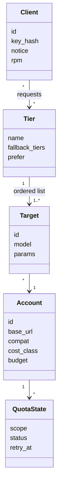

---

## 5. Architecture

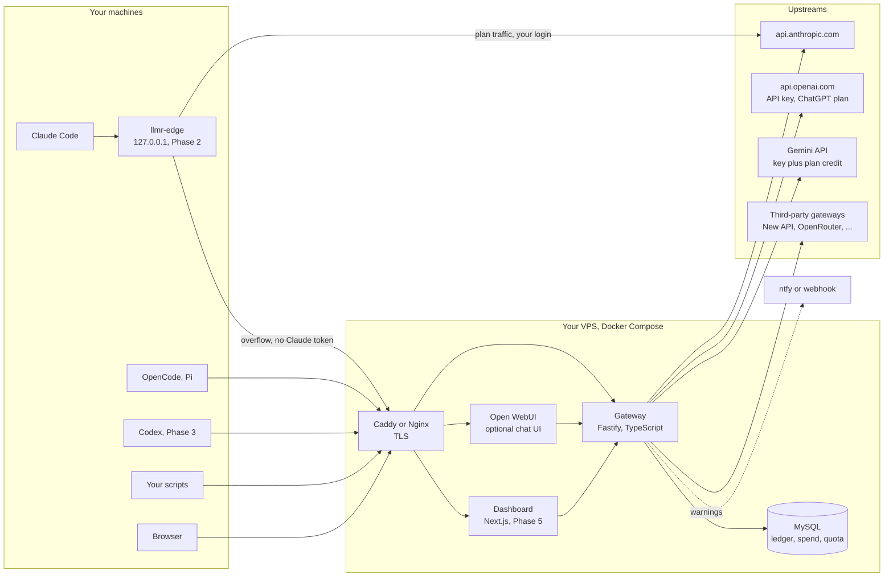

### Inside the gateway

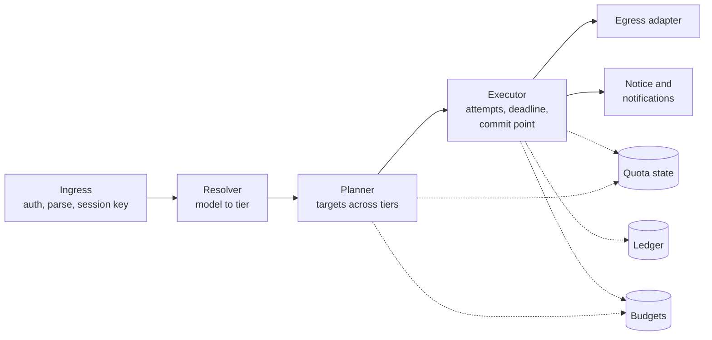

| Component               | Responsibility                                                                                    | Phase                                  |
| ----------------------- | ------------------------------------------------------------------------------------------------- | -------------------------------------- |
| **Ingress**             | Authenticates the client, parses the dialect, derives the session key, builds a `RequestContext`. | 1 (Chat), 2 (Messages), 3 (Responses)  |
| **Resolver**            | Maps a model string to a tier, or to the targets serving an exact model.                          | 1                                      |
| **Planner**             | Expands the tier and its fallback tiers into an ordered list of usable targets.                   | 1                                      |
| **Executor**            | Runs attempts, enforces timeouts, holds stream events until the commit point, applies outcomes.   | 1                                      |
| **Egress adapters**     | Build the upstream request, send it, and classify errors.                                         | 1 (Chat), 2 (Anthropic), 3 (Responses) |
| **Translator**          | Converts between dialects through a common representation.                                        | 3                                      |
| **Quota store**         | Account and model quota states, written through to MySQL.                                         | 1                                      |
| **Budgets and pricing** | Spend limits for metered accounts.                                                                | 1                                      |
| **Ledger**              | One row per request and per attempt, with tokens and cost. No prompt content.                     | 1                                      |
| **Notifier**            | Push notifications, deduplicated by episode.                                                      | 1                                      |
| **Edge**                | Local helper for Claude Code.                                                                     | 2                                      |
| **Session pins**        | Keep a conversation on one target to protect the prompt cache.                                    | 3                                      |
| **Dashboard**           | Web UI for status, usage and client keys.                                                         | 5                                      |

**Process model.** The gateway is one Node.js process in one container. In Phase 1, quota state is cached in memory and written through to MySQL. Section 10 describes how it grows to several instances.

---

## 6. Request lifecycle

1. **Authenticate** the client key.
2. **Parse** the request and derive the session key.
3. **Resolve** the model string to a tier.
4. **Plan** an ordered list of steps: the tier's usable targets, then those of its fallback tiers. Exhausted, cooling-down or over-budget targets are skipped.
5. **Execute** each step. For streams, events are held until the commit point. A failure before it updates quota state and moves to the next step.
6. **Respond** with `x-llmr-*` headers. If a fallback tier served the request, add the notice for clients that opted in and send one notification per episode.
7. **Record** every attempt, and settle spend from the reported usage.

### Tier fallback with a warning (Phase 1)

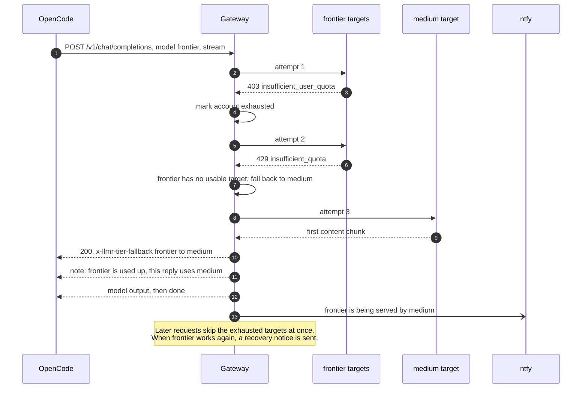

### Claude Code overflow through the edge (Phase 2 and 3)

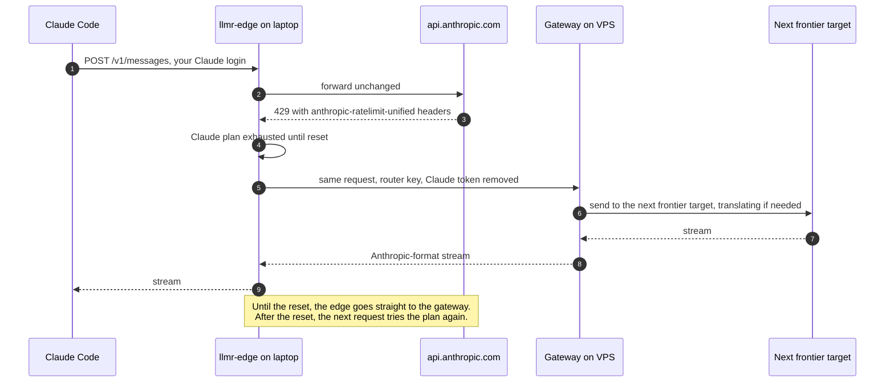

### Streaming commit point

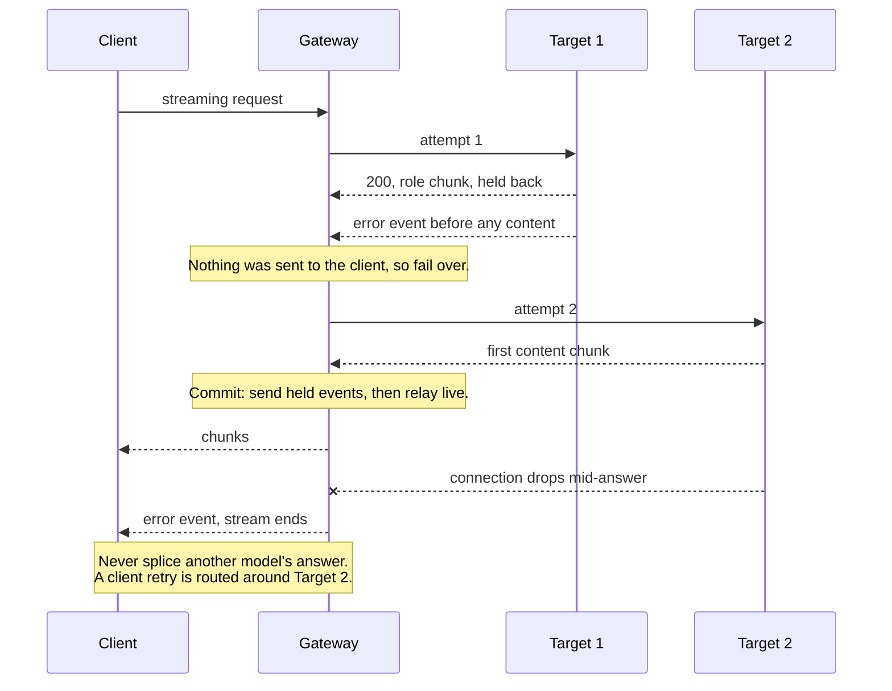

---

## 7. Client integration

Details and example files are in [Appendix A](#appendix-a-client-setup).

| Client                              | Speaks to the router                           | Credential                   | Session identity                                | How you see a warning             | Phase |
| ----------------------------------- | ---------------------------------------------- | ---------------------------- | ----------------------------------------------- | --------------------------------- | ----- |
| **OpenCode**                        | Chat Completions (`openai-compatible` package) | Router key                   | Derived from the conversation                   | Note in the reply, push           | 1     |
| **Pi**                              | Chat Completions (`api: openai-completions`)   | Router key                   | `x-session-affinity` when enabled, else derived | Note in the reply, push           | 1     |
| **Chat UI** (Open WebUI, LibreChat) | Chat Completions                               | Router key                   | `X-Session-Id` set from the UI's chat ID        | Note in the reply, push           | 1     |
| **Your scripts**                    | Chat Completions (OpenAI SDK)                  | Router key                   | Optional `X-Session-Id`                         | Response headers, push            | 1     |
| **Claude Code**                     | Anthropic Messages, through `llmr-edge`        | Claude login stays local     | `x-claude-code-session-id`                      | Status line, desktop notification | 2     |
| **Codex**                           | Responses API only                             | Router key via a `--profile` | `session-id` header                             | Note in the reply, push           | 3     |

Facts from the client docs that shape the gateway:

- **Codex accepts only the Responses API.** Its docs say `responses` "is the only supported value" for `wire_api`, and a working Chat Completions endpoint "doesn't establish Responses compatibility". The gateway serves that API directly.
- **OpenCode and Pi do not discover models from a custom endpoint.** You list `frontier`, `medium` and `flash` in their config, with context limits.
- **OpenCode requires a `finish_reason`** by default and requests stream usage through `stream_options.include_usage`. The gateway must honor both.
- **Advertise the smallest context window in the fallback chain.** Clients compact based on the number you give them. If you tell a client 1M and it lands on a 200K model, the request fails.
- **Overflow errors must look standard.** The gateway returns OpenAI's `context_length_exceeded` code so clients compact and retry. Pi documents this behavior.

---

## 8. Low-level design

### 8.1 Tech stack

| Layer                 | Choice                                                              | Why                                                                                                                                                        |
| --------------------- | ------------------------------------------------------------------- | ---------------------------------------------------------------------------------------------------------------------------------------------------------- |
| Language              | **TypeScript 6** (strict, ESM)                                      | The most common choice for this kind of service, and one language across gateway, edge and dashboard. typescript-eslint does not support TypeScript 7 yet. |
| Runtime               | **Node.js 26 LTS** in containers; 22 or later works for development | Excellent at many concurrent streams.                                                                                                                      |
| HTTP server           | **Fastify 5**                                                       | Popular, fast, good TypeScript support, and it lets a route take over the raw response for streaming.                                                      |
| Upstream HTTP         | **undici**                                                          | Node's own HTTP engine: connection pools and separate connect, header and body timeouts.                                                                   |
| Validation            | **Zod 4**                                                           | Config and request validation with inferred types.                                                                                                         |
| Config format         | **YAML** in git, secrets in environment variables                   | Reviewable routing policy.                                                                                                                                 |
| Database              | **MySQL 8.4 LTS**                                                   | Very widely used, and the ledger needs joins, aggregates and atomic counters.                                                                              |
| Database access       | **Drizzle ORM** with drizzle-kit migrations                         | Typed SQL with no separate engine binary.                                                                                                                  |
| Shared state at scale | **Redis** (Phase 6)                                                 | The standard choice for atomic counters and locks across instances.                                                                                        |
| Dashboard             | **Next.js 16, React 19, Tailwind CSS, shadcn/ui** (Phase 5)         | Your preferred front-end stack.                                                                                                                            |
| Chat UI               | **Open WebUI** in Docker                                            | A popular chat UI that already works with OpenAI-compatible APIs. Building one adds nothing.                                                               |
| Reverse proxy         | **Caddy 2** on a fresh VPS, or your existing **Nginx**              | Caddy gets TLS certificates automatically. Your New API host already runs Nginx, so a config for it is included.                                           |
| Containers            | **Docker** and **Docker Compose**                                   | One command to run everything. Kubernetes only if the scaling plan needs it.                                                                               |
| CI/CD                 | **GitHub Actions**, images in **GHCR**                              | Lint, type-check, test and build on every push.                                                                                                            |
| Logs and metrics      | **Pino**, later **Prometheus** and **Grafana**                      | Structured logs with secret redaction.                                                                                                                     |
| Tests                 | **Vitest**, with the official `openai` SDK as a test client         | If the SDK works unchanged, the gateway is compatible.                                                                                                     |
| Lint and format       | **ESLint**, **typescript-eslint**, **Prettier**                     | The usual setup.                                                                                                                                           |
| Packages              | **pnpm** workspaces                                                 | Fast, strict, and suited to a monorepo.                                                                                                                    |

**Why not these?**

- **MongoDB.** It is a good database, but this data is relational: attempts belong to requests, reports need `GROUP BY`, and budgets need atomic counters.
- **Next.js for the gateway.** Route handlers are a poor fit for long-lived streams with mid-request failover and fine-grained timeouts. Next.js is used where it shines, for the dashboard.
- **Provider SDKs inside adapters.** A gateway must forward unknown fields, read rate-limit headers and relay streams exactly. Raw HTTP is simpler for that.

**Supply-chain rules.** A compromised package on a server that holds API keys is a serious risk: LiteLLM's PyPI releases 1.82.7 and 1.82.8 carried a credential stealer in March 2026. So runtime dependencies stay few, versions are locked, CI installs with a frozen lockfile, and pnpm's minimum release age delays brand-new versions.

### 8.2 Repository layout

```text
llm-rudder/
├── apps/
│   ├── gateway/                 # Phase 1: the VPS service
│   │   ├── src/
│   │   │   ├── main.ts          # process entry point
│   │   │   ├── app.ts           # builds the Fastify app (also used by tests)
│   │   │   ├── cli.ts           # keygen, check-config, ChatGPT sign-in commands
│   │   │   ├── runtime.ts       # wires the services together
│   │   │   ├── dev/             # fake upstream and the demo
│   │   │   ├── chatgpt/         # the ChatGPT sign-in held on the VPS
│   │   │   ├── config/          # Zod schema, YAML loader, compat profiles
│   │   │   ├── auth/            # client keys, rate limits, failed-auth throttle
│   │   │   ├── ingress/         # chat, messages, responses, edge and admin routes
│   │   │   ├── routing/         # resolver, planner, capability filter, session pins
│   │   │   ├── execution/       # executor, one passthrough protocol per API format, notices
│   │   │   ├── translate/       # common format, one codec per API format, reasoning store
│   │   │   ├── upstream/        # HTTP client, classifiers, SSE parser, tool extras
│   │   │   ├── state/           # quota state machine and stores
│   │   │   ├── billing/         # pricing, budgets
│   │   │   ├── ledger/          # request and attempt records
│   │   │   ├── notify/          # notifier, fallback episodes
│   │   │   └── db/              # Drizzle schema and migrations runner
│   │   ├── drizzle/             # generated SQL migrations
│   │   └── test/                # unit and end-to-end tests, fake upstream
│   ├── edge/                    # llmr-edge: Claude Code helper and ChatGPT sign-in
│   └── dashboard/               # Phase 5: Next.js
├── packages/
│   └── shared/                  # header rules, JSON edits, edge protocol, ChatGPT sign-in types
├── config/                      # example config and pricing
├── deploy/                      # Dockerfile, Caddyfile, Nginx example
├── docs/
├── docker-compose.yml
└── pnpm-workspace.yaml
```

### 8.3 Configuration

Routing policy lives in `config/config.yaml`. Secrets live in `.env`. The config names environment variables and never holds a secret.

```yaml
version: 1

server:
  host: 0.0.0.0
  port: 4141
  trust_proxy: true # true behind Caddy or Nginx
  max_body_mb: 32

admin:
  key_env: LLMR_ADMIN_KEY

clients:
  - { id: opencode, key_env: LLMR_KEY_OPENCODE, notice: text }
  - { id: pi, key_env: LLMR_KEY_PI, notice: text }
  - { id: chat-ui, key_env: LLMR_KEY_CHAT_UI, notice: text }
  - { id: scripts, key_env: LLMR_KEY_SCRIPTS, notice: none, rpm: 120 }

accounts:
  my-gateway: # your New API instance
    base_url_env: MY_GATEWAY_BASE_URL
    api_key_env: MY_GATEWAY_API_KEY
    compat: new_api
    cost_class: prepaid
    trust: self_hosted
  gemini-key:
    base_url: https://generativelanguage.googleapis.com/v1beta/openai
    api_key_env: GEMINI_API_KEY
    compat: gemini
    cost_class: metered
    trust: first_party
    budget: { monthly_usd: 10 } # matches the Google AI Pro developer credit
  openai-key:
    base_url: https://api.openai.com/v1
    api_key_env: OPENAI_API_KEY
    compat: openai
    cost_class: metered
    trust: first_party
    budget: { daily_usd: 5, monthly_usd: 50 }

tiers:
  frontier:
    fallback_tiers: [medium, flash]
    prefer: quality
    context_window: 200000 # what /v1/models reports
    targets:
      - { account: my-gateway, model: claude-opus-5-5 }
      - { account: openai-key, model: gpt-6-astra, params: { reasoning_effort: high } }
      - { account: gemini-key, model: gemini-4-carbon }
  medium:
    fallback_tiers: [flash]
    prefer: quality
    context_window: 200000
    targets:
      - { account: gemini-key, model: gemini-4-hydrogen }
      - { account: my-gateway, model: claude-sonnet-5-5 }
      - { account: openai-key, model: gpt-6.1-sol }
  flash:
    fallback_tiers: [medium]
    prefer: quality
    context_window: 200000
    targets:
      - { account: gemini-key, model: gemini-3.5-flash-lite }
      - { account: openai-key, model: gpt-6-luna }
      - { account: my-gateway, model: claude-haiku-5-5 }

aliases: # first match wins
  - { match: "claude-opus-*", tier: frontier }
  - { match: "claude-fable-*", tier: frontier }
  - { match: "claude-sonnet-*", tier: medium }
  - { match: "claude-haiku-*", tier: flash }
  - { match: strong, tier: frontier }
  - { match: balanced, tier: medium }
  - { match: fast, tier: flash }

routing:
  max_attempts_per_tier: 3
  deadline_s: 900

timeouts:
  connect_s: 10
  first_byte_s: 120 # until upstream response headers arrive
  commit_s: 300 # until the first model output
  stream_idle_s: 300 # silence after the commit point
  keepalive_after_s: 20 # then start the client stream and send keep-alives
  keepalive_interval_s: 15

notifications:
  ntfy_url_env: LLMR_NTFY_URL
  webhook_url_env: LLMR_WEBHOOK_URL
  repeat_after_s: 3600

pricing_file: pricing.yaml
```

**`prefer`** decides what happens before falling back:

- `quality` (default): use every target in this tier, including metered ones within budget, before moving to the next tier.
- `cost`: use all non-metered targets across the tier and its fallback tiers first, and only then spend on metered targets.

**For Claude Code (Phase 2):**

```yaml
clients:
  - { id: claude-code, key_env: LLMR_KEY_CLAUDE_CODE, notice: none, edge: true }

accounts:
  anthropic-key:
    api: anthropic.messages # the default is openai.chat
    base_url: https://api.anthropic.com
    api_key_env: ANTHROPIC_API_KEY
    cost_class: metered
    trust: first_party
    budget: { daily_usd: 10, monthly_usd: 100 }
  claude-plan: { kind: edge_only, cost_class: prepaid, trust: first_party } # never called by the VPS

edge:
  plan_account: claude-plan
  plan_models: { frontier: claude-opus-5-5, medium: claude-sonnet-5-5, flash: claude-haiku-5-5 }
  report_interval_s: 300
```

An `anthropic.messages` account sends its key in `x-api-key`. Set `auth_header: bearer` for a third-party gateway that expects `Authorization`.

**For translation (Phase 3):**

```yaml
accounts:
  openai-key:
    api: openai.responses # openai.chat is the default
    base_url: https://api.openai.com/v1
    api_key_env: OPENAI_API_KEY
    cost_class: metered

tiers:
  frontier:
    targets:
      - { account: openai-key, model: gpt-6.2-astra, effort: high } # used when the client sets none

routing:
  prefer_same_format: true # try accounts in the client's own format first

models_file: models.yaml # what each model accepts
```

**Added in Phase 4:** `chatgpt-plan: { kind: chatgpt_plan, cost_class: prepaid, trust: first_party, enabled: false }`. It has no URL, key or budget. Its sign-in is stored in the gateway's state directory.

**Validation.** Config that breaks these rules does not load:

- Every target names an existing account, every fallback and alias names an existing tier, and every referenced environment variable is set.
- Every client key is at least 32 characters and unique.
- `fallback_tiers` cannot include the tier itself.
- A value that looks like a secret (`sk-…`, `llmr_…`) is rejected inside the YAML.
- An `edge_only` account cannot be a tier target.
- `params` apply only to `openai.chat` accounts. Use `effort` on the others. A target's `effort` applies whenever the client sets none, including requests that pass through untranslated.
- A warning is printed when a metered account has no budget, or a tier has only one target.

### 8.4 Core types

These are simplified from the code in `apps/gateway/src`.

```ts
type Dialect = "openai.chat" | "openai.responses" | "anthropic.messages";
type CostClass = "prepaid" | "free" | "metered";
type NoticeMode = "text" | "none";

interface RequestContext {
  requestId: string;
  client: ClientConfig;
  dialect: Dialect;
  body: ChatRequest; // parsed; unknown fields are kept
  requestedModel: string;
  stream: boolean;
  wantsUsage: boolean; // the client asked for stream usage
  sessionKey: string;
  allowFallback: boolean;
  deadlineAt: number;
  signal: AbortSignal; // aborted when the client disconnects
}

interface Target {
  id: string; // "frontier/openai-key/gpt-6-astra"
  tier: string;
  accountId: string;
  model: string;
  params: Record<string, unknown>;
}

interface PlanStep {
  target: Target;
  isFallback: boolean; // served by a tier other than the requested one
}

interface Plan {
  requestedTier: string;
  steps: PlanStep[];
  skipped: SkippedTarget[]; // why a target was left out, for errors and status
}

type Outcome =
  | "ok"
  | "quota_exhausted"
  | "rate_limited"
  | "billing"
  | "overloaded"
  | "upstream_error"
  | "timeout"
  | "auth"
  | "unsupported"
  | "context_overflow"
  | "client_error"
  | "refusal"
  | "mid_stream_failure"
  | "client_aborted";

interface Classified {
  outcome: Outcome;
  retryElsewhere: boolean;
  scope?: "account" | "model";
  retryAfterS?: number;
  resetsAt?: number; // epoch milliseconds
  code?: string;
  message?: string;
}

interface QuotaStore {
  get(accountId: string, scope: string): QuotaState;
  set(accountId: string, scope: string, state: QuotaState): void;
  all(): QuotaEntry[];
}
```

### 8.5 Resolver and planner

**Resolution order.** The first match wins.

1. The `X-LLMR-Tier` header.
2. A model string equal to a tier name.
3. A model string matching an alias.
4. A model string equal to an upstream model ID: every target serving that model, with no tier fallback.
5. Otherwise `404 model_not_found`, listing the tiers.

`X-LLMR-No-Fallback: 1` keeps a request inside its tier.

```ts
function buildPlan(ctx: RequestContext, cfg: Config, state: RouterState, now: number): Plan {
  const { tier, targets: exact } = resolve(ctx, cfg);
  if (exact) return planFromTargets(tier, exact, state, now);

  const chain = ctx.allowFallback ? [tier, ...cfg.tiers[tier].fallbackTiers] : [tier];
  const ordered =
    cfg.tiers[tier].prefer === "cost"
      ? [...targetsOf(chain).filter(notMetered), ...targetsOf(chain).filter(isMetered)]
      : targetsOf(chain);

  const steps: PlanStep[] = [];
  const skipped: SkippedTarget[] = [];
  const perTier = new Map<string, number>();
  for (const target of ordered) {
    const blocked = whyBlocked(target, ctx, state, now); // quota, budget, disabled
    if (blocked) {
      skipped.push({ target, reason: blocked });
      continue;
    }
    const used = perTier.get(target.tier) ?? 0;
    if (used >= cfg.routing.maxAttemptsPerTier) continue;
    perTier.set(target.tier, used + 1);
    steps.push({ target, isFallback: target.tier !== tier });
  }
  return { requestedTier: tier, steps, skipped };
}
```

**Order within a tier.** Targets in the client's own API format go first, keeping their listed order, because they need no translation and keep prompt caching and reasoning intact. `prefer_same_format: false` turns this off.

**Capability filter.** A target is skipped when `config/models.yaml` says its model cannot serve the request:

- images or documents it cannot read,
- tools, when the model calls tools only through another API,
- a request larger than its context window,
- hosted tools the request depends on, unless the target belongs to that provider,
- `previous_response_id`, unless the target speaks the Responses API.

Models not listed are assumed capable. If a request has ordinary tools too, optional hosted tools such as Codex's web search are dropped on translation.

### 8.6 Executor and streaming

**Timeouts:**

| Setting             | Default | Meaning                                                                                                     |
| ------------------- | ------- | ----------------------------------------------------------------------------------------------------------- |
| `connect_s`         | 10 s    | TCP and TLS to the upstream.                                                                                |
| `first_byte_s`      | 120 s   | Until response headers arrive. Third-party gateways may retry internally, so this is generous.              |
| `commit_s`          | 300 s   | Until the first model output. Reasoning models can think for minutes before any output.                     |
| `stream_idle_s`     | 300 s   | Silence after the commit point.                                                                             |
| `keepalive_after_s` | 20 s    | If no output has arrived by then, start the client stream and send keep-alive comments.                     |
| `deadline_s`        | 900 s   | Time to reach the first model output, across all attempts. For a non-streaming request, the whole response. |

**The commit point for Chat Completions** is the first chunk with non-empty `content`, `tool_calls`, a reasoning field (`reasoning_content`, `reasoning`, `reasoning_text`), or a `finish_reason`. Earlier chunks, such as a role-only chunk, are held back.

**Status codes and keep-alives.** Headers are not sent until the commit point, so a fast failure can still return a real HTTP error. If nothing has arrived after `keepalive_after_s`, the gateway sends `200` and `: keep-alive` comments, which stops proxies and clients from timing out. From then on, a final failure can only be reported as an SSE error event. OpenRouter uses the same comment technique.

```ts
async function execute(ctx: RequestContext, plan: Plan, out: ClientResponse): Promise<void> {
  const attempts: AttemptRecord[] = [];
  for (const step of plan.steps) {
    if (Date.now() > ctx.deadlineAt || ctx.signal.aborted) break;
    if (!quota.tryAdmit(step.target)) continue; // takes the probe slot if needed
    const hold = budgets.reserve(step.target, ctx);
    if (!hold) continue;

    const result = await attempt(ctx, step, out, hold);
    attempts.push(result.record);
    applyOutcome(step.target, result.classified);

    if (result.delivered) return finish(ctx, plan, step, attempts);
    if (!result.classified.retryElsewhere) return out.sendError(result.classified, attempts);
  }
  return out.sendAllFailed(plan, attempts);
}
```

**After the commit point:**

- Events are relayed as they arrive. A usage-only chunk is removed unless the client asked for usage.
- If the upstream fails, the client gets an error event and the stream ends. The attempt is recorded as `mid_stream_failure`.
- The router never joins two models' output in one response.
- If the client disconnects, the upstream request is aborted.

**When every step fails:**

| Situation                                  | Response                                                                                         |
| ------------------------------------------ | ------------------------------------------------------------------------------------------------ |
| All targets are blocked by quota or budget | `429` with `retry-after` set to the earliest known reset, and a body listing each target's state |
| All attempts failed for other reasons      | `502` with `code: all_targets_failed` and the last upstream error                                |
| A non-retryable client error               | The upstream's `4xx`, in the client's dialect                                                    |
| The stream had already started             | An SSE error event                                                                               |

### 8.7 Outcome classification

Classification is a pure function, so every rule has a unit test. It runs on HTTP errors, on `200` bodies containing `error`, and on stream events.

| Outcome              | Typical signals                                                                                                                                                                                        | Try the next target?                                           | State change                                                                             |
| -------------------- | ------------------------------------------------------------------------------------------------------------------------------------------------------------------------------------------------------ | -------------------------------------------------------------- | ---------------------------------------------------------------------------------------- |
| `ok`                 | `2xx`, then a normal finish                                                                                                                                                                            | —                                                              | Clears failures and probes.                                                              |
| `quota_exhausted`    | OpenAI `insufficient_quota`; New API `insufficient_user_quota`, `pre_consume_token_quota_failed`; OpenRouter `402`; Gemini Prepay `402`; "quota" or "balance" wording, including 额度不足 and 余额不足 | Yes                                                            | Account `exhausted` until a known reset, otherwise `backoff`.                            |
| `rate_limited`       | `429` without quota wording; Gemini `RESOURCE_EXHAUSTED`                                                                                                                                               | Yes                                                            | Model `cooldown` for `retry-after`, capped at 5 minutes, otherwise 5 s doubling to 60 s. |
| `overloaded`         | `503`, `529`, `overloaded_error`                                                                                                                                                                       | Yes                                                            | Model `cooldown`, 15 s.                                                                  |
| `upstream_error`     | `500`, `502`, connection errors, an HTML error page, an empty stream                                                                                                                                   | Yes                                                            | Model `cooldown`, 10 s doubling.                                                         |
| `timeout`            | Connect, first-byte, commit or idle timeout                                                                                                                                                            | Yes, before commit                                             | Model `cooldown`, 30 s.                                                                  |
| `auth`               | `401`                                                                                                                                                                                                  | Yes                                                            | Account `disabled` until you fix it. Sends a notification.                               |
| `billing`            | `403` permission or plan problems                                                                                                                                                                      | Yes                                                            | Account `backoff`.                                                                       |
| `unsupported`        | `404` model not found; New API `503 model_not_found`, `get_channel_failed`, `channel:no_available_key`; a `400` naming an unsupported parameter                                                        | Yes                                                            | Model `cooldown`, 10 minutes.                                                            |
| `context_overflow`   | `context_length_exceeded`, "maximum context length", "prompt is too long"                                                                                                                              | **No**                                                         | Returned to the client with the standard code, so it compacts.                           |
| `client_error`       | Other `400` and `422`                                                                                                                                                                                  | No                                                             | None.                                                                                    |
| `refusal`            | Content filter, New API `sensitive_words_detected`, `prompt_blocked`                                                                                                                                   | **No.** The router does not shop for a model that will comply. | None.                                                                                    |
| `mid_stream_failure` | Any failure after the commit point                                                                                                                                                                     | No                                                             | Model `cooldown`.                                                                        |

Errors also carry a scope: the account, one model, or only this request. The ChatGPT plan's codes are listed in [section 8.13](#chatgpt-plan-phase-4). A service that passes on errors from its own upstreams is handled differently, as [section 8.10](#810-third-party-gateways) explains.

### 8.8 Quota state

```ts
interface QuotaState {
  status: "ok" | "cooldown" | "exhausted" | "backoff" | "probing" | "disabled";
  retryAt?: number; // epoch ms: when the target may be tried again
  backoffS?: number; // 900, 1800, 3600 ... capped at 14400
  failures?: number; // consecutive short failures
  probeStartedAt?: number;
  detail?: string;
}
```

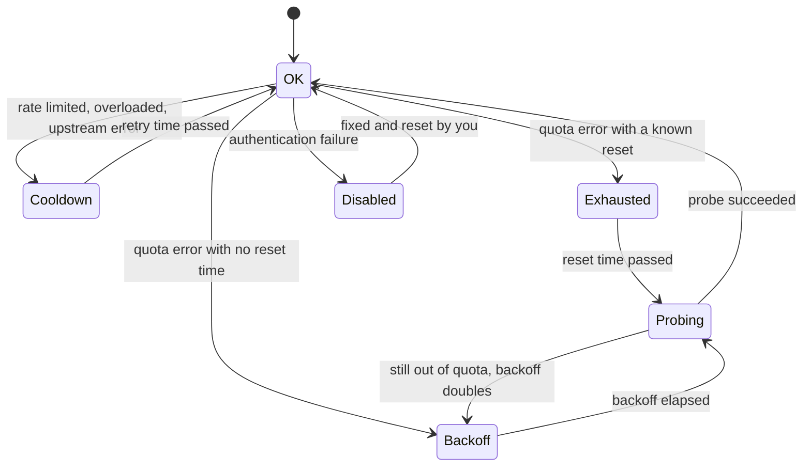

- **Probing.** After a reset, the next real request is the probe. No synthetic requests are sent. Only one probe runs at a time; others keep using the fallback.
- **Persistence.** Long-lived states (`exhausted`, `backoff`, `disabled`) are written to MySQL, so a restart does not hammer an exhausted account. The exception is a stopped key-based account: a restart is how a replaced key takes effect, so it gets another try. Short cooldowns stay in memory.
- **Account pauses.** A temporary failure that covers a whole account pauses it for 15 seconds, doubling up to 5 minutes. It does not shorten a usage-limit backoff that is being rechecked.
- **Failures of one request** change no state, so one unsupported input cannot block other requests.
- **Circuit breaker.** When at least five recent attempts exist and half of them failed for health reasons, the target rests for 30 seconds, doubling up to 5 minutes. One request then tests it.
- **Health order.** When a quarter of a target's recent attempts failed, it moves behind other targets of the same tier and cost class. It never moves behind a more expensive class.

### 8.9 Tier fallback and warnings

This is the behavior you asked for: drop to a lower tier instead of failing, and say so.

**What counts as a fallback.** A request is served by a tier other than the one it asked for. Moving between targets _inside_ a tier is normal failover. It appears in headers and the ledger but does not interrupt you.

**Four warning channels:**

| Channel                                  | Who sees it                                      | When                                                   |
| ---------------------------------------- | ------------------------------------------------ | ------------------------------------------------------ |
| **Response headers**                     | Scripts, logs                                    | Every fallback response                                |
| **Note in the reply**                    | Clients with `notice: text`                      | First fallback reply in each conversation, per episode |
| **Push notification**                    | Your phone or desktop, through ntfy or a webhook | Once per episode, repeated hourly if it continues      |
| **Status line and desktop notification** | Claude Code                                      | Phase 2, through the edge                              |

**Headers:**

```text
x-llmr-request-id: 01KA...
x-llmr-requested-tier: frontier
x-llmr-served-tier: medium
x-llmr-target: medium/gemini-key/gemini-4-hydrogen
x-llmr-attempts: 3
x-llmr-fallback: my-gateway:quota_exhausted,openai-key:quota_exhausted
x-llmr-tier-fallback: frontier->medium
```

**The note** is ordinary assistant text placed before the model's output:

```text
> ⚠️ llm-rudder: `frontier` is unavailable (quota exhausted), so this reply uses `medium` (gemini-4-hydrogen).
```

It is **never** added when the request sets `response_format`, asks for more than one choice, or the client has `notice: none`. So structured output and scripts stay clean. In a stream it is sent just after the commit point, so it does not affect failover.

**Episodes.** An episode starts at the first fallback for a requested tier and ends when that tier serves a request again. The start and end each produce one notification.

Other notifications use the same channel: an account exhausted or recovered, a budget reached, an authentication failure, and the first metered fallback of the day.

### 8.10 Third-party gateways

Any OpenAI-compatible service can be an account. Compatibility quirks live in a **compat profile**, not in code branches.

```ts
interface CompatProfile {
  maxTokensField: "keep" | "max_tokens" | "max_completion_tokens";
  streamUsage: boolean; // accepts stream_options.include_usage
  systemRole: "keep" | "system"; // rewrite "developer" messages
  dropFields: string[]; // fields this upstream rejects
  toolExtras: boolean; // keep tool_calls[].extra_content (Gemini)
  relaysErrors: boolean; // passes on errors from its own upstreams
}
```

Built-in profiles: `openai`, `gemini`, `new_api`, `openrouter`, `generic`. An account can override any field.

**How your New API instance behaves.** These facts come from its public source (`relaykit/types/error.go`, `controller/relay.go`, `service/billing*.go`) and an unauthenticated request to your instance, which runs v1.0.0-rc.47.

| Situation                   | What New API returns                                                                                        | Router's reading             |
| --------------------------- | ----------------------------------------------------------------------------------------------------------- | ---------------------------- |
| Bad key                     | `401`, `{"error":{"code":"","message":"Invalid token ...","type":"new_api_error"}}` (seen on your instance) | `auth`                       |
| Out of quota                | `403`, `insufficient_user_quota` or `pre_consume_token_quota_failed`                                        | `quota_exhausted`            |
| No channel for the model    | `503`, `model_not_found`                                                                                    | `unsupported` for that model |
| No channel available        | `get_channel_failed`, `channel:no_available_key`                                                            | `unsupported` for that model |
| Content blocked             | `sensitive_words_detected`, `prompt_blocked`                                                                | `refusal`                    |
| Error after streaming began | A `data:` event `{"error":{...}}` with no `choices`                                                         | Error event                  |
| A channel fails             | The channel's status, `type` and `code`, passed on unchanged                                                | A relayed failure, see below |

**Rules that apply to all gateways:**

- **Do not trust the status code alone.** Some return `200` with `error` in the body, or send the error in the stream. OpenRouter does this after it has accepted a request.
- **Non-JSON error pages** from a CDN or proxy count as `upstream_error`.
- **Do not retry what the gateway already retried.** New API has its own channel retry, so the router moves on to a different target.
- **Relayed errors describe one route.** A `401`, a `403` or "out of quota" from a gateway may be about one of its channels, not your key, and the next request may take another channel. For an account with `relaysErrors`, such a failure rests only that target for a few seconds, and repeated failures trip its circuit breaker. In the background the router asks the service itself, at most once a minute, with `GET /models` and, for quota errors, the balance route. The whole account stops only if that confirms the problem.
- **Which accounts relay errors.** `new_api` accounts do. So do `generic` accounts unless they are `first_party`, because an unnamed service may have anything behind it. `compat_overrides.relays_errors` sets it explicitly.
- **Divide the work between the layers.** The router chooses the model and when to leave an account. The gateway chooses the channel for that model. A gateway target adds capacity only if its channels do not draw on the same subscription as the targets before it.
- **Loop guard.** The router sends `x-llmr-hop` with its instance ID, and refuses a request carrying its own ID. New API does not forward unknown headers by default, so a channel pointing back at the router needs the header override `{"x-llmr-hop": "{client_header:x-llmr-hop}"}`. Without it the guard cannot see the loop.
- **Trust levels.** `self_hosted` for your own gateway, `third_party` for others. A gateway is only as private as what it forwards to, so use `third_party` when its channels include outside services. A client can be limited to certain accounts with `allow_accounts`, so sensitive scripts never reach a third party.
- **Model honesty.** The router records the `model` the upstream reports, and the dashboard's request page shows when it differs. This catches only honest mislabeling: research shows black-box checks cannot reliably prove which model answered.
- **Balance checks (Phase 5).** New API exposes `GET /v1/dashboard/billing/subscription` and `/usage` to the same key. OpenRouter exposes `GET /api/v1/key`. These can warn before a balance reaches zero.

**Gemini tool calls.** Gemini 3 and 4 require thought signatures to be returned on function calls and answer `400` without them. Community reports place the signature at `tool_calls[].extra_content.google.thought_signature` in the OpenAI format; Google's page does not show the path, so Phase 0 confirms it. Coding clients often drop unknown fields, so the gateway keeps a short-lived map from tool call ID to `extra_content` and restores it on the next request. `extra_content` is removed for non-Gemini upstreams. When history came from another model, it uses Google's documented bypass value `skip_thought_signature_validator`.

### 8.11 Sessions and pinning

The **session key** is taken from the first of these that is present:

1. `x-claude-code-session-id`
2. `X-Session-Id`
3. `x-session-affinity` or `x-session-id`
4. `X-OpenWebUI-Chat-Id`
5. `prompt_cache_key` in the body
6. A hash of the client ID, the first system message and the first user message

Phase 1 uses it only so that the note appears once per conversation.

**Pinning.** A pin keeps a conversation on one target, because switching providers means re-sending the whole prompt uncached. Pins are stored in MySQL.

- Key: `(client, session, requested tier)`. Set on success, without overwriting a concurrent winner.
- A pinned target goes first, ahead of the normal order.
- A short throttle (`retry-after` of 10 s or less) on the pinned target waits and retries it once.
- Failover moves the pin.
- A pin on a **fallback tier** is released as soon as the requested tier has a working target.
- A pin on a metered target moves back when a prepaid target above it recovers.
- Pins expire after 10 minutes idle, matching the prompt cache.

### 8.12 The edge (Phase 2)

`llmr-edge` (`apps/edge`) is a small Node.js process on each computer that runs Claude Code. It builds into one file with no runtime dependencies, starts at login through launchd or systemd, and listens only on `127.0.0.1:4142`.

**It holds:** the router key and an edge key in a private config file, the latest routing plan, and plan state.
**It never stores or logs:** the Claude token or any request content. The token exists only inside the request being forwarded.

`GET /router/edge/plan` returns a list of steps for each Claude model pattern. The edge keeps a copy, so routing survives a VPS outage:

```text
Request for claude-opus-5-5 (tier frontier):
  plan                       ← the model Claude Code asked for
  gateway:frontier
  plan:claude-sonnet-5-5     ← fallback: Sonnet may still have quota
  gateway:medium
  plan:claude-haiku-5-5
  gateway:flash
```

A tier with `prefer: cost` lists every plan step first. A tier with no account this client may use has no gateway step. Any account can serve Claude Code, through translation when needed.

- A `plan` step goes to `api.anthropic.com` with Claude Code's request unchanged, except `model` on a fallback step.
- A `gateway` step goes to the VPS with the router key, `X-LLMR-Tier` and `X-LLMR-No-Fallback: 1`, so the edge stays in control of the order.

| What happens                                                                    | What the edge does                                                                                        |
| ------------------------------------------------------------------------------- | --------------------------------------------------------------------------------------------------------- |
| Anthropic answers with anything except a plan limit, including 401, 429 and 5xx | Returns it unchanged. Claude Code refreshes its login and retries by itself.                              |
| Anthropic reports a plan limit                                                  | Records the limit and moves to the next step.                                                             |
| A limit is already recorded                                                     | Skips plan steps for the affected models until the reset. The next request then tries the plan again.     |
| The gateway streams an answer                                                   | Passes it through.                                                                                        |
| The gateway returns an upstream's client error (`x-llmr-upstream-error: 1`)     | Returns it unchanged, because Claude Code's recovery depends on the exact wording.                        |
| The gateway fails in any other way, or cannot be reached                        | Moves to the next step. These errors never reach Claude Code, where a 401 would look like a failed login. |
| No step can serve                                                               | Returns Anthropic's original `429`, so Claude Code shows its normal limit message.                        |
| Every step was skipped                                                          | Asks Anthropic once anyway, for an authentic answer.                                                      |

**Detecting a plan limit.** A `429` counts as a plan limit when it has `anthropic-ratelimit-unified-*` headers and one of these is true: the overall status or a window's status is anything other than `allowed` or `allowed_warning`, a window's utilization is 1 or more, or `x-should-retry` is `false`. Any other `429` is a temporary throttle. `overage` values are ignored, because they describe extra usage rather than the plan. The edge waits for the last exhausted window's reset, or the general reset, or a `retry-after` above 60 seconds. With no reset time it backs off from 15 minutes up to 4 hours. A limit on one model family (for example `seven_day_opus`) blocks only that family.

These rules are a best reading. One public report shows the header names on a successful response, but no public source shows a real limit response. So every plan `429` is saved to `edge-limit-samples.jsonl`, with rate-limit headers only, and `llmr-edge doctor` reports how many exist. If a real limit is misread, Claude Code simply shows its normal message and nothing is sent to the gateway.

**Keeping the token local:**

- Gateway requests are built from an allowlist: `anthropic-*` headers without credential-like names, session IDs, and the router key. The `oauth-*` beta value is removed.
- A request whose body contains its own credential, for example after a tool read a credentials file, never goes to the gateway.
- The login can only go to `https://api.anthropic.com`. Other hosts are refused at startup, except loopback for tests, and a crafted path cannot change the host.
- Reports to the gateway hold plan state only, and the gateway rejects any other field.

**Who can use the edge.** Model requests must carry `x-llmr-edge-key`, which Claude Code sends through `ANTHROPIC_CUSTOM_HEADERS` without affecting the login. Requests with an `Origin` header or an unexpected `Host` are refused, so a web page cannot reach the port or spend through the router key.

**Warnings.** `llmr-edge statusline` prints one line for Claude Code's `statusLine` setting. Desktop notifications announce a limit, the move to the gateway and recovery, at most once per message every 15 minutes. Reports let the gateway show plan state and send its push notifications.

### 8.13 Passthrough and translation

#### Anthropic passthrough rules (Phase 2)

These come from Claude Code's gateway compatibility guide and apply on the edge and on the gateway's Anthropic adapter.

**May change:** `model`, when the target differs; and auth headers. The model is replaced in the original bytes, because parsing and re-encoding could reorder numeric keys or change number formats and so break the prompt cache.

**Must not change:**

- The `system` array, its order or its block form. Claude Code's attribution block must stay first, in its own entry.
- `cache_control` markers, wherever they appear.
- `anthropic-version` and `anthropic-beta`, and unknown `anthropic-*` headers and body fields.
- The order of `messages` and `tools`.
- The event stream, including `ping` events once output has started.
- Inference requests use `/v1/messages?beta=true`, so routes match on the path and the `beta` value is kept.

**On the way back:** error bodies are forwarded unmodified; `retry-after` is integer seconds; `x-should-retry` and `anthropic-ratelimit-unified-*` are forwarded.

**Commit point.** The first `content_block_*` or `message_delta` event. An `error` event before it moves to the next target. After it, the gateway sends an `error` event and ends the stream, because Claude Code treats a stream that stops early as a dropped connection.

**Moving from the plan to an API key.** The new account starts with an empty prompt cache, so the first request pays a full cache write. Anthropic's docs say a thinking block the new account cannot use "never causes an error": the API drops it, and Claude answers without that reasoning. If a signature is rejected anyway, Claude Code removes earlier thinking blocks and retries, which only works because error bodies are forwarded unchanged. The docs do not cover blocks produced under a claude.ai login specifically, so this needs confirming on a real plan limit.

#### Translation (Phase 3)

Each API format has a codec that decodes into a common form and encodes from it, so three codecs cover all six pairs. A request whose target speaks the client's format skips this and passes through.

```ts
interface IRRequest {
  system: string[];
  messages: { role: "system" | "user" | "assistant"; blocks: Block[] }[];
  tools: IRTool[];
  hostedTools: IRHostedTool[];
  hostedToolsRequired: boolean;
  toolChoice?: IRToolChoice;
  parallelToolCalls?: boolean;
  maxOutputTokens?: number;
  temperature?: number;
  topP?: number;
  stop?: string[];
  effort?: Effort;
  reasoningSummary?: boolean;
  responseFormat?: IRResponseFormat;
}
type Block = Text | Image | Document | ToolCall | ToolResult | Reasoning;
```

| Concept           | `anthropic.messages`                                                | `openai.chat`                                    | `openai.responses`                         |
| ----------------- | ------------------------------------------------------------------- | ------------------------------------------------ | ------------------------------------------ |
| System prompt     | Top-level `system`, `system` messages                               | `system` or `developer` message                  | `instructions`, `developer` input items    |
| Tool definition   | `{name, description, input_schema}`                                 | `{type: function, function: {...}}`              | `{type: function, name, parameters}`       |
| Tool call         | `tool_use {id, name, input}`                                        | `tool_calls[{id, function}]`                     | `function_call {call_id, name, arguments}` |
| Tool result       | `tool_result` in a user turn                                        | `role: tool` message                             | `function_call_output`                     |
| Tool choice       | `auto`, `none`, `any`, `{type: tool}`                               | `auto`, `none`, `required`, `{type: function}`   | Same as Chat                               |
| Output limit      | `max_tokens` (required)                                             | `max_completion_tokens` or `max_tokens`          | `max_output_tokens`                        |
| Reasoning         | `thinking: {type: adaptive}`, `output_config.effort`                | `reasoning_effort`                               | `reasoning: {effort}`                      |
| Structured output | `output_config.format`                                              | `response_format`                                | `text.format`                              |
| Stop reason       | `end_turn`, `max_tokens`, `tool_use`, `refusal`                     | `stop`, `length`, `tool_calls`, `content_filter` | `status`, `incomplete_details`             |
| Usage             | `input_tokens` excludes cache                                       | `prompt_tokens` includes cache                   | `input_tokens` includes cache              |
| Stream            | `message_start`, `content_block_*`, `message_delta`, `message_stop` | `chat.completion.chunk`, `[DONE]`                | `response.*` events, `response.completed`  |

**Rules from current Claude models,** recorded per model in `config/models.yaml`:

- Drop `temperature` and `top_p`.
- Do not force `tool_choice` on Opus 5.5, Sonnet 5.5 or Fable 5.2.
- A request cannot end with an assistant prefill, so the text moves into a user message asking Claude to continue.
- Thinking cannot be turned off on Opus 5.5, so an effort of `none` becomes `low`.
- If `max_tokens` is missing, use 16,000 for non-streaming and 64,000 for streaming, capped by the model.
- Use top-level automatic caching on first-party accounts, and an explicit marker on the system prompt elsewhere.

**Other mappings:**

- A client's reasoning effort is sent only to models the catalog lists, using the closest level each accepts.
- Tool names that a provider would reject are shortened with a hash and mapped back. Responses `namespace` tools are flattened the same way.
- Gemini gets tool schemas reduced to the keywords it documents, and its thought signatures are kept and returned.
- Claude Code's attribution line and `metadata` are removed. Deferred tools stay hidden until a `tool_reference` has loaded them.
- Anthropic's own OpenAI-compatible endpoint is **not** used. Its docs say it is "not considered a long-term or production-ready solution for most use cases".

**Reasoning artifacts** are never sent to a different provider. When a client in another format cannot carry them, the gateway keeps them for six hours, keyed by the tool call they led to, and returns them only to the account that produced them. Providers need them back during a tool loop. They stay in memory and are never logged.

**What does not translate:** provider-run tools and the MCP connector. A request that depends on them stays with that provider.

#### ChatGPT plan (Phase 4)

A `chatgpt_plan` account uses OpenAI's Sign in with ChatGPT instead of an API key. These rules come from OpenAI's guide for open-source apps, last read on 2026-11-18.

**Sign-in and transfer.** OpenAI's callback address only reaches the computer running the browser, so you sign in on your laptop.

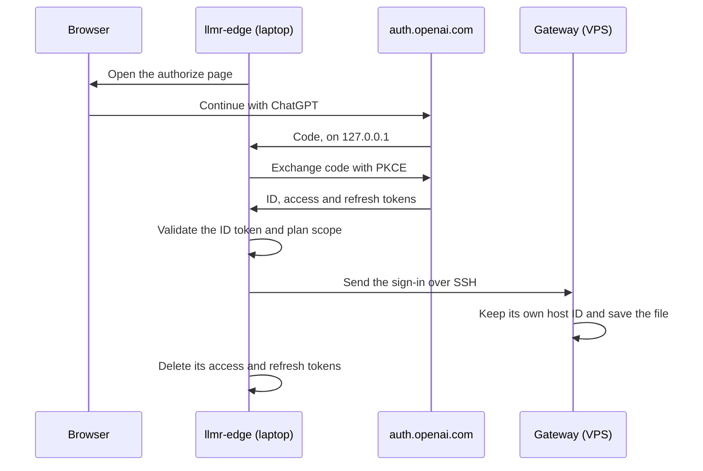

- The ID token's signature, issuer, audience, expiry and nonce are checked. A returning sign-in must be the same account and client.
- Plan use needs the `chatgpt.tokens.use.direct` scope. Without it only the registration is kept, and the next login asks for consent again.
- If OpenAI rejects the code with `invalid_grant`, login starts one fresh authorization with the issued client ID.
- The VPS creates its host ID before it saves a transferred sign-in. `llmr-edge chatgpt login --for TARGET` reads that ID, so later authorizations use the VPS's own host ID, and then sends the result.

**Storage.** Each sign-in is `/state/chatgpt/<account>.json`, written atomically with mode `0600` in a `0700` folder. `/state` is a Docker volume and the only writable path that survives an update. The gateway looks for a replaced file every 5 seconds, so a new sign-in needs no restart.

**Renewal.** Only the VPS refreshes. One refresh runs at a time, and its rotated tokens are saved together. A token is renewed 5 minutes before expiry, unless `earliest_refresh_at` is later and the token is still valid. After a `401`, the request is retried once with a newer token. Every 15 minutes the gateway checks whether the plan's model list is 6 hours old. Reading it needs a current token, which also keeps an idle session alive. One gateway process owns each sign-in, because refresh tokens rotate. Running several instances needs the shared lock in [section 10](#10-scaling-plan).

| Refresh result                                                                                                                          | What happens                                        |
| --------------------------------------------------------------------------------------------------------------------------------------- | --------------------------------------------------- |
| `invalid_grant`, `invalid_refresh_token`, `token_expired`, `refresh_token_expired`, `refresh_token_invalidated`, `refresh_token_reused` | Tokens are cleared, the account stops, you are told |
| `invalid_client`                                                                                                                        | The account stops, tokens stay, you are told        |
| Network failure or any other error                                                                                                      | Tokens stay. A still-valid token keeps being used   |

**Requests.** Every request is rewritten, including those from Responses clients, because the plan has its own rules. It always sets `store: false` and `stream: true`, sends instructions as developer messages, and leaves out `max_output_tokens`, `temperature` and `top_p`. Client tools go in one namespace called `tools`, which is removed from the calls clients receive. A forced tool becomes the only tool offered, with `tool_choice: required`, because `tool_choice` cannot name a namespaced tool. A client that did not ask to stream gets one response assembled from the stream, and only `response.completed` or `response.incomplete` counts as an ending.

**Seen on the real service (2026-11-18).** The stream arrives without a `content-type` header, so the plan's responses are always read as a stream. Function calls come back with `namespace: "tools"`, and a follow-up that sends them back is accepted. The request ID is in `x-oai-request-id`, and streams can include a `response.metadata` event, which the gateway ignores. For a one-hour token, `earliest_refresh_at` was about 54 minutes after issue. A real refresh on the VPS returned a new refresh token, and it kept working after a restart.

**Routing.** The plan keeps its configured place in a tier even though most clients speak another format. It is skipped when nobody is signed in, when its model list lacks the model, and for requests that need stored state, files uploaded by ID, or hosted tools other than web search.

| Error                                                                                                    | Treated as                | Effect                                                        |
| -------------------------------------------------------------------------------------------------------- | ------------------------- | ------------------------------------------------------------- |
| `subscription_sharing_usage_limit_exceeded`, over HTTP or in `response.failed`                           | Quota, reset unknown      | Backoff from 15 minutes to 4 hours, with one probe at a time  |
| `subscription_sharing_usage_unavailable`, `subscription_sharing_user_unavailable`, or `503` with no code | Temporary account problem | Account pause                                                 |
| `subscription_sharing_unsupported_capability`                                                            | This request              | Next target, unless `param` is `model`, which rests the model |
| `subscription_sharing_route_not_supported`                                                               | Unsupported               | The model rests for 10 minutes                                |
| `subscription_sharing_user_not_eligible`, `chatpass_v2_*`, `403` with no code                            | Account rejected          | Account stops, and you are told why                           |
| `subscription_sharing_invalid_user` or `401`, after one renewal and retry                                | Account rejected          | Account stops, and you are asked to sign in again             |

A new sign-in clears these states. A restart also clears a stopped account that still has tokens, so it gets another try. Usage limits are kept across restarts.

### 8.14 HTTP API

| Method and path                                                                   | Purpose                                         | Auth                 | Phase |
| --------------------------------------------------------------------------------- | ----------------------------------------------- | -------------------- | ----- |
| `POST /v1/chat/completions`                                                       | Chat Completions, streaming and not             | Client key           | 1     |
| `GET /v1/models`                                                                  | Tiers, in OpenAI list format                    | Client key           | 1     |
| `GET /healthz`                                                                    | Liveness                                        | None                 | 1     |
| `GET /readyz`                                                                     | Config loaded and database reachable            | None                 | 1     |
| `GET /router/status`                                                              | Accounts, tiers, spend, episodes, recent events | Admin key            | 1     |
| `POST /router/accounts/:id/reset`                                                 | Clear a `disabled` or `exhausted` state         | Admin key            | 1     |
| `POST /v1/messages`, `/v1/messages/count_tokens`                                  | Anthropic Messages                              | Client key           | 2     |
| `GET /router/edge/plan`, `POST /router/edge/report`                               | Edge configuration and state                    | Client key           | 2     |
| `POST /v1/responses`                                                              | Responses API, for Codex                        | Client key           | 3     |
| `GET /router/codex/models`                                                        | Codex model catalog                             | Client key           | 3     |
| `GET /metrics`                                                                    | Prometheus                                      | Admin or metrics key | 5     |
| `GET /router/usage`, `/router/requests`, `/router/requests/:id`, `/router/events` | Reports for the dashboard                       | Admin key            | 5     |
| `GET`, `POST /router/clients`, `DELETE /router/clients/:id`                       | List, create and revoke client keys             | Admin key            | 5     |
| `GET /router/settings`, `POST /router/config/reload`                              | Running settings, and loading a changed config  | Admin key            | 5     |

**Authentication.** `Authorization: Bearer llmr_…`, or `x-api-key`. The edge routes need a client with `edge: true`.

**Optional request headers:** `X-LLMR-Tier`, `X-LLMR-No-Fallback`, `X-Session-Id`. From an edge client only: `X-LLMR-Requested-Tier` and `X-LLMR-Plan-Exhausted`, which record what happened before the request reached the gateway.

**Errors** use the OpenAI shape, so SDKs handle them normally. Routes under `/v1/messages` use Anthropic's shape instead:

```json
{
  "error": { "message": "...", "type": "router_error", "param": null, "code": "all_targets_failed" }
}
```

### 8.15 Data model

MySQL 8.4 with `utf8mb4`. Money is integer micro-USD. Times are UTC. The source of truth is the Drizzle schema in `apps/gateway/src/db/schema.ts`.

```sql
CREATE TABLE requests (
  id              CHAR(26)     NOT NULL PRIMARY KEY,   -- ULID
  started_at      DATETIME(3)  NOT NULL,
  finished_at     DATETIME(3)  NULL,
  client_id       VARCHAR(64)  NOT NULL,
  session_hash    CHAR(16)     NOT NULL,
  requested_model VARCHAR(128) NOT NULL,
  requested_tier  VARCHAR(32)  NULL,
  served_tier     VARCHAR(32)  NULL,
  served_target   VARCHAR(255) NULL,
  stream          BOOLEAN      NOT NULL,
  outcome         VARCHAR(32)  NULL,
  http_status     SMALLINT     NULL,
  attempt_count   SMALLINT     NOT NULL DEFAULT 0,
  KEY requests_started (started_at),
  KEY requests_client_started (client_id, started_at)
);

CREATE TABLE attempts (
  request_id        CHAR(26)     NOT NULL,
  n                 SMALLINT     NOT NULL,
  target_id         VARCHAR(255) NOT NULL,
  account_id        VARCHAR(64)  NOT NULL,
  model             VARCHAR(128) NOT NULL,
  returned_model    VARCHAR(128) NULL,
  started_at        DATETIME(3)  NOT NULL,
  ttft_ms           INT          NULL,
  duration_ms       INT          NULL,
  http_status       SMALLINT     NULL,
  outcome           VARCHAR(32)  NOT NULL,
  error_code        VARCHAR(128) NULL,
  input_tokens      INT          NULL,    -- excludes cached tokens
  cached_tokens     INT          NULL,
  output_tokens     INT          NULL,    -- includes reasoning tokens
  usage_complete    BOOLEAN      NOT NULL DEFAULT TRUE,
  cost_micro_usd    BIGINT       NULL,    -- metered accounts only
  list_micro_usd    BIGINT       NULL,    -- same tokens at list price
  PRIMARY KEY (request_id, n),
  KEY attempts_account_started (account_id, started_at)
);

CREATE TABLE spend (
  account_id      VARCHAR(64) NOT NULL,
  period          VARCHAR(16) NOT NULL,   -- 'day:2026-11-18' or 'month:2026-11'
  spent_micro_usd BIGINT      NOT NULL DEFAULT 0,
  PRIMARY KEY (account_id, period)
);

CREATE TABLE quota_state (
  account_id VARCHAR(64)  NOT NULL,
  scope      VARCHAR(160) NOT NULL,
  status     VARCHAR(16)  NOT NULL,
  retry_at   DATETIME(3)  NULL,
  backoff_s  INT          NULL,
  detail     VARCHAR(255) NULL,
  updated_at DATETIME(3)  NOT NULL,
  PRIMARY KEY (account_id, scope)
);

CREATE TABLE events (
  id       BIGINT       NOT NULL AUTO_INCREMENT PRIMARY KEY,
  at       DATETIME(3)  NOT NULL,
  kind     VARCHAR(48)  NOT NULL,
  subject  VARCHAR(160) NOT NULL,
  message  VARCHAR(500) NOT NULL,
  KEY events_at (at)
);
```

`session_pins` holds each conversation's current target. `client_keys` holds dashboard clients, with only a SHA-256 hash of each key. `usage_daily` holds totals by day, client, account and model.

**Retention.** An hourly job saves daily totals, then removes `requests`, `attempts` and `events` older than the configured limits, 90 days by default. Daily totals are kept. Reports read the last three days from the ledger, so they are always current.

### 8.16 Pricing, budgets and the ledger

**Pricing** lives in `config/pricing.yaml`, in USD per 1M tokens. It is versioned, and it is configuration: providers change prices, and Gemini's change on specific dates.

```yaml
version: "2026-11-18"
default: { input: 10, output: 50 } # conservative price for unknown models
models:
  gpt-6-astra: { input: 10, output: 50 }
  gpt-6.1-sol: { input: 2, output: 10 }
  gpt-6-luna: { input: 0.10, output: 0.50 }
  gemini-4-carbon: { input: 4, output: 20, cached_input: 0.20 } # price from 2026-12-01
  gemini-4-hydrogen: { input: 1.50, output: 7.50, cached_input: 0.075 }
  gemini-3.5-flash-lite: { input: 0.30, output: 2.50, cached_input: 0.03 }
  claude-opus-5-5:
    { input: 4, output: 20, cached_input: 0.20, cache_write_5m: 5, cache_write_1h: 8 }
  claude-sonnet-5-5:
    { input: 2, output: 10, cached_input: 0.10, cache_write_5m: 2.50, cache_write_1h: 4 }
```

Anthropic bills cache writes above the input price and reports them separately, so the ledger records them too. `long_context` sets different prices above an input size, which Claude Haiku 5.5 uses for prompts over 100,000 tokens.

**Budgets** apply per metered account, per UTC day and month:

1. **Reserve.** Before an attempt, the router estimates the cost: input tokens from the request size (characters ÷ 4), plus output tokens capped at 8,000. The target is skipped if `spent + reserved + estimate` exceeds a budget.
2. **Settle.** After the attempt, the reservation is replaced by the actual cost from reported usage. If usage is missing, the estimate is charged and `usage_complete` is false.
3. **Overshoot.** Spend can pass the limit by roughly one request's difference between estimate and actual. That is acceptable for one user. Treat these budgets as a safety net, and also set provider-side limits.

Spend is an atomic `INSERT ... ON DUPLICATE KEY UPDATE`. Ledger writes go through an in-memory queue, so a slow database never delays a response. If MySQL is down, requests keep working; records are dropped after the queue fills, and an error is logged.

### 8.17 Security

The VPS holds real API keys and is reachable from the internet, so security is part of Phase 1.

| Threat                          | Control                                                                                                                                                                                                                                          |
| ------------------------------- | ------------------------------------------------------------------------------------------------------------------------------------------------------------------------------------------------------------------------------------------------ |
| Stranger calls the gateway      | Every `/v1/*` route needs a client key of at least 32 random characters, checked before the body is read. Keys are compared as SHA-256 digests in constant time.                                                                                 |
| Key guessing                    | Failed authentication is throttled per IP. A valid key still works, so one misconfigured app cannot lock out the others.                                                                                                                         |
| A leaked client key burns money | Per-client `rpm` and concurrency limits, per-account budgets, one key per client so one can be revoked alone.                                                                                                                                    |
| Traffic interception            | TLS at Caddy or Nginx. The gateway port is not published to the internet.                                                                                                                                                                        |
| Secrets in logs                 | Pino redacts `authorization`, `x-api-key` and related headers. Prompts and completions are never logged. Stored session identifiers are hashes.                                                                                                  |
| Secrets in git                  | `.env` is ignored. The config rejects inline secrets. CI can add a secret scan.                                                                                                                                                                  |
| Admin API exposure              | A separate admin key, and the reverse proxy blocks `/router/*` from the internet, except `/router/edge/*`, which needs an `edge: true` client key, and `/router/codex/*`, which needs a client key. Use an SSH tunnel or Tailscale for the rest. |
| Container escape                | Runs as a non-root user with a read-only filesystem, no capabilities, and `no-new-privileges`.                                                                                                                                                   |
| Dependency compromise           | Few dependencies, locked versions, frozen installs, delayed adoption of new releases.                                                                                                                                                            |
| Subscription tokens             | The Claude token never reaches the VPS ([section 8.12](#812-the-edge-phase-2)). ChatGPT tokens sit in an owner-only file in the gateway's state volume and are only sent to OpenAI. They never appear in logs or the status page.                |
| Other programs using the edge   | It listens on loopback only, needs its own key for model requests, and refuses browser origins and unexpected `Host` values.                                                                                                                     |
| Request loops and abuse         | Hop guard, body size limit and request deadline.                                                                                                                                                                                                 |

The host itself needs the usual care: SSH keys only, a firewall allowing only 22, 80 and 443, and automatic security updates.

### 8.18 Observability

- **Logs:** one JSON line per request and per attempt, with no content.
- **`GET /router/status`:** the live view in Phase 1.
- **Metrics:** `GET /metrics` reports requests by client, tier and outcome; attempts by target; latency; time to first output; fallbacks; tokens; spend; list-price value; target availability; balances; and memory. Labels never contain request content. `deploy/monitoring` holds the Prometheus and Grafana setup.
- **Uptime:** an external monitor on `/healthz`.

Example status output:

```json
{
  "accounts": [
    {
      "id": "my-gateway",
      "costClass": "prepaid",
      "state": { "status": "exhausted", "retryAt": "2026-11-18T15:45:00Z" }
    },
    {
      "id": "openai-key",
      "costClass": "metered",
      "state": { "status": "ok" },
      "spend": { "dayUsd": 1.2, "dayLimitUsd": 5, "monthUsd": 9.4, "monthLimitUsd": 50 }
    }
  ],
  "fallbacks": [
    { "requestedTier": "frontier", "servedTier": "medium", "since": "2026-11-18T14:02:11Z" }
  ]
}
```

### 8.19 Dashboard (Phase 5)

A Next.js app with the App Router, React Server Components, Tailwind CSS and components in the shadcn/ui style. Its server talks to the gateway's admin API over the private Docker network, so the browser never holds the admin key.

| Page         | Shows                                                                          |
| ------------ | ------------------------------------------------------------------------------ |
| **Overview** | Tier health, active fallbacks, today's totals and recent events                |
| **Accounts** | State, limits, budgets and balances, with **Try again now**                    |
| **Usage**    | Requests, tokens, spend and list-price value by day, client, account and model |
| **Requests** | A searchable log and each request's attempts, with no prompts or answers       |
| **Clients**  | Every client, plus creating and revoking keys. A new key is shown once         |
| **Settings** | Routing, tiers, retention and notification status, with **Reload config**      |

**Login.** One password, stored as a scrypt hash. A signed session cookie is `HttpOnly` and `SameSite=Strict`, lasts seven days, is limited to HTTPS in production, and stops working when the password changes. Failed attempts are limited per address and overall. A proxy check redirects visitors without a session, and every data request checks again.

### 8.20 Testing

| Level                  | What it covers                                                                                                                                                                                                                                    |
| ---------------------- | ------------------------------------------------------------------------------------------------------------------------------------------------------------------------------------------------------------------------------------------------- |
| **Unit**               | Resolver, planner, classifier, quota state machine (fake clock), SSE parser, budgets, notices.                                                                                                                                                    |
| **End to end**         | The real gateway against a scriptable fake upstream, over real HTTP: streaming, failover, fallback, mid-stream failure, keep-alives and client disconnects.                                                                                       |
| **Contract**           | The official `openai` and `@anthropic-ai/sdk` packages as clients, for streaming, tools and error handling.                                                                                                                                       |
| **Database**           | Migrations and budget counters against real MySQL in CI.                                                                                                                                                                                          |
| **Fixtures**           | Recorded, scrubbed upstream responses from Phase 0, including your New API instance.                                                                                                                                                              |
| **Client smoke tests** | OpenCode, Pi, Open WebUI, and later Codex, run by hand at each release. `pnpm smoke:claude-code`, `pnpm smoke:codex` and `pnpm smoke:clients` run the real Claude Code, Codex, OpenCode and Pi CLIs with fake credentials and no outside network. |
| **Canary**             | A daily GitHub Actions run of the Claude Code and Codex smoke tests against each client's newest release.                                                                                                                                         |
| **Load (Phase 5)**     | Added latency and memory per stream against the fake upstream.                                                                                                                                                                                    |

`pnpm demo` runs the whole fallback story locally with fake upstreams and no credentials.

---

## 9. Deployment

### 9.1 Topology

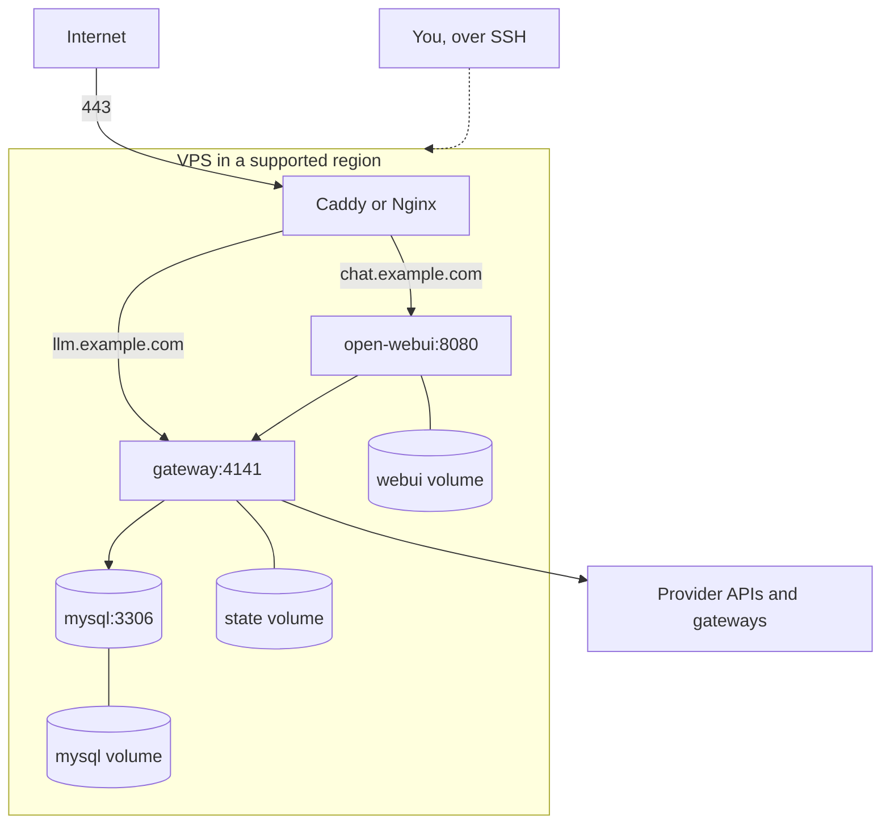

Only the reverse proxy publishes ports. MySQL and the gateway stay on the private Docker network.

### 9.2 Sizing

| Setup             | Suggested VPS               |
| ----------------- | --------------------------- |
| Gateway and MySQL | 2 vCPU, 2 GB RAM, 20 GB SSD |
| With Open WebUI   | 2 vCPU, 4 GB RAM, 40 GB SSD |

These are starting points. The gateway mostly waits on the network.

### 9.3 First deployment

The tested steps are in [`DEPLOYMENT.md`](DEPLOYMENT.md). Database passwords go into `.env` before the first build, because Docker Compose reads them even then. Remove the accounts you do not use, because every account left in the config needs its URL and key.

**If the VPS already runs Nginx**, as your New API host does, skip the `caddy` profile and use `deploy/nginx/llm-rudder.conf.example`. Streaming needs these settings:

```nginx
location /v1/ {
    proxy_pass http://127.0.0.1:4141;
    proxy_http_version 1.1;
    proxy_set_header Connection "";
    proxy_set_header Host $host;
    proxy_set_header X-Forwarded-For $remote_addr;  # a client must not be able to fake this
    proxy_set_header X-Forwarded-Proto $scheme;
    proxy_buffering off;
    proxy_request_buffering off;
    proxy_read_timeout 3600s;
    proxy_send_timeout 3600s;
    client_max_body_size 32m;
}
```

### 9.4 Updates and rollback

| Stage       | Flow                                                                                                                                                                                                         |
| ----------- | ------------------------------------------------------------------------------------------------------------------------------------------------------------------------------------------------------------ |
| **Phase 1** | `git pull && docker compose up -d --build` on the VPS.                                                                                                                                                       |
| **Phase 5** | GitHub Actions builds an image tagged with the commit SHA and pushes it to GHCR. A deploy job or a manual `docker compose pull && docker compose up -d` applies it. Rollback means pinning the previous tag. |

Migrations run at startup, are additive, and are compatible with the previous release.

**Graceful shutdown.** On `SIGTERM` the gateway stops accepting requests, fails readiness, and lets active streams finish for up to `stop_grace_period` (5 minutes in Compose).

### 9.5 Backups

- Planned for Phase 5: a nightly `mysqldump`, compressed and copied off the VPS. Until then, use the manual commands in [`DEPLOYMENT.md`](DEPLOYMENT.md#8-what-to-back-up).
- `config/` is in version control. `.env` is stored in your password manager.
- The state volume holds the ChatGPT sign-in. Leave it out of backups. If it is lost, sign in again.
- Restore is tested once per phase.

---

## 10. Scaling plan

For one user, **Stage 1 is expected to be enough for a long time.** The other stages exist so that early choices do not block later growth. Provider limits are usually reached long before the gateway's own.

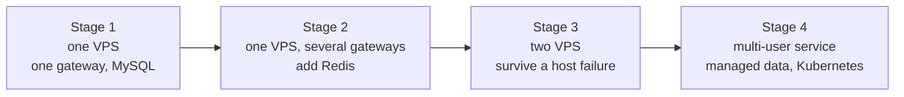

| Stage                    | Move here when                                               | What runs                                                                                                  | What changes in the code                                                                                                                  |
| ------------------------ | ------------------------------------------------------------ | ---------------------------------------------------------------------------------------------------------- | ----------------------------------------------------------------------------------------------------------------------------------------- |
| **1. Single instance**   | Now                                                          | 1 gateway, MySQL, reverse proxy                                                                            | Nothing. State is in memory with write-through to MySQL.                                                                                  |
| **2. Several instances** | CPU stays above about 60%, or you want zero-downtime deploys | 2–4 gateway containers behind the proxy, plus Redis                                                        | `QuotaStore`, budget reservations, pins, rate limits and fallback episodes move to Redis behind the same interfaces.                      |
| **3. Two hosts**         | A VPS failure would hurt too much                            | Active VPS and standby VPS in different supported regions, replicated MySQL, DNS or load-balancer failover | Health-based failover. Each host gets its own ChatGPT host ID, and only one refreshes tokens at a time.                                   |
| **4. Multi-user**        | Other people use it                                          | Kubernetes or a managed container service, managed MySQL and Redis, object storage for exports             | Per-user accounts and credentials, reservation-based budgets, organizations, audit log. Each person connects **their own** subscriptions. |

**Design rules that keep this possible:**

- **All shared state goes through interfaces** (`QuotaStore`, `BudgetStore`, `PinStore`, `EpisodeStore`). In Stage 1 they are in-process.
- **Streams do not need sticky routing.** A stream lives on one instance until it ends. The next request can land anywhere, because pins and quota are shared.
- **Atomic operations only.** Budget reservation and pin creation are single atomic Redis operations in Stage 2, never read-then-write.
- **One token refresher.** ChatGPT token refresh takes a Redis lock, because refresh tokens rotate.
- **Failure of Redis degrades, not stops.** Instances fall back to local state and log loudly. Budgets become stricter by reserving a smaller share per instance.
- **The ledger scales separately.** Monthly partitions on `requests` and `attempts`, a daily rollup table, and later a read replica for the dashboard. Writes stay asynchronous.

**Measure before scaling.** `pnpm load-test` runs against the fake upstream. On an Apple Silicon laptop, the gateway added about 0.2 ms at the median and 0.4 to 0.6 ms at the 95th percentile, handled about 8,700 short requests per second, and held 1,000 open streams at about 33 KB each. A provider's own latency and limits will matter far sooner. Stage 2's triggers should be set from those numbers.

---

## 11. Delivery phases

The checklist version is in [`TODO.md`](TODO.md).

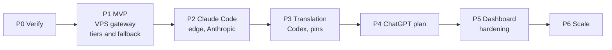

| Phase                          | What you get                                                                                                                               | Rough size for one developer |
| ------------------------------ | ------------------------------------------------------------------------------------------------------------------------------------------ | ---------------------------- |
| **0. Verify**                  | Real responses recorded, and the plan rules tested on your accounts                                                                        | 1–2 days, alongside Phase 1  |
| **1. MVP**                     | One HTTPS endpoint with tiers, failover, fallback and warnings, budgets, and third-party gateways. OpenCode, Pi, chat UI and scripts work. | About 1 week                 |
| **2. Claude Code**             | Claude Code on your plan, continuing on an Anthropic key when the plan runs out                                                            | About 1 week                 |
| **3. Translation**             | Any client can reach any model, Claude Code can continue on GPT or Gemini, Codex works, and conversations stay pinned                      | 2–3 weeks                    |
| **4. ChatGPT plan**            | Your ChatGPT plan serves every client                                                                                                      | About 1 week                 |
| **5. Dashboard and hardening** | Web dashboard, usage reports, metrics, CI/CD deploys, load tests                                                                           | 2–3 weeks                    |
| **6. Scale**                   | Redis, several instances, a second host, and optionally multiple users                                                                     | Open-ended                   |

---

## 12. Decisions and trade-offs

| #   | Decision                                                | Rejected                                 | Why                                                                                                                                                                                              |
| --- | ------------------------------------------------------- | ---------------------------------------- | ------------------------------------------------------------------------------------------------------------------------------------------------------------------------------------------------ |
| D1  | TypeScript on Node.js                                   | Python, Go                               | Your preference and a single language across services. Node handles streaming I/O well. Go remains a possible port if a single binary matters later.                                             |
| D2  | Fastify for the gateway, Next.js only for the dashboard | One Next.js app                          | Long-lived proxy streams and a web UI have different needs.                                                                                                                                      |
| D3  | MySQL                                                   | MongoDB, PostgreSQL                      | Relational data, and your preference. PostgreSQL would also work.                                                                                                                                |
| D4  | VPS-first, with a small edge for Claude Code            | Sending the Claude token through the VPS | It keeps the login off an internet-facing server, keeps plan traffic on your normal network, matches Anthropic's wording most closely, and survives a VPS outage. The cost is one local process. |
| D5  | Chat Completions first                                  | Starting with translation                | It covers four of six client types with one adapter pair.                                                                                                                                        |
| D6  | Automatic tier fallback, with warnings                  | Returning an error                       | Your stated preference. A task should not fail because a tier ran out.                                                                                                                           |
| D7  | `prefer: quality` by default                            | Falling back before spending             | "Frontier" keeps meaning frontier until the budget is reached. `prefer: cost` flips it per tier.                                                                                                 |
| D8  | A visible note in the reply, opt-in per client          | Headers only                             | Most interactive clients never show headers, so a warning there would go unseen.                                                                                                                 |
| D9  | Fail over only before the commit point                  | Splicing streams                         | Splicing produces incoherent text and can repeat tool calls.                                                                                                                                     |
| D10 | Never fail over on refusals                             | Trying another provider                  | The router should not shop for a model that will comply.                                                                                                                                         |
| D11 | Compat profiles for third-party gateways                | Per-vendor code                          | New gateways become configuration.                                                                                                                                                               |
| D12 | Gemini through an API key and plan credit               | Using the plan login                     | Google warns of suspension or termination.                                                                                                                                                       |
| D13 | Open WebUI for chat                                     | Building a chat UI                       | Mature, popular and already compatible.                                                                                                                                                          |
| D14 | Ordered lists as routing policy                         | Weights or optimizers                    | Predictable and easy to debug.                                                                                                                                                                   |
| D15 | The gateway sends the edge a step list                  | Routing rules inside the edge            | Routing policy stays in one config file, and the edge keeps working from its saved copy.                                                                                                         |
| D16 | A separate key between Claude Code and the edge         | Trusting anything on loopback            | The edge holds a key that can spend money. `ANTHROPIC_CUSTOM_HEADERS` adds the check without replacing the Claude login.                                                                         |
| D17 | Replace `model` in the original bytes                   | Parse and re-encode the JSON             | It guarantees that nothing else changes, which keeps prompt caching and signatures intact.                                                                                                       |
| D18 | Try the client's own format first within a tier         | Always following the listed order        | Native targets keep prompt caching and reasoning. `prefer_same_format: false` restores the listed order.                                                                                         |
| D19 | Keep reasoning on the gateway across formats            | Hiding it in fake thinking signatures    | Clients stay valid if the conversation returns to its original provider, which would reject a made-up signature.                                                                                 |
| D20 | Write our own Codex catalog instructions                | Copying OpenAI's prompt                  | The catalog needs instructions, a tier can be any provider's model, and a short general prompt is easy to maintain.                                                                              |

---

## 13. Risks and open questions

| Risk                                                                                                                                                     | Mitigation                                                                                                                                           |
| -------------------------------------------------------------------------------------------------------------------------------------------------------- | ---------------------------------------------------------------------------------------------------------------------------------------------------- |
| **Anthropic's rules on intermediating login tokens.** Even a local helper might be judged against that wording, and enforcement may come without notice. | The token stays local and goes only to Anthropic. Claude Code can run without the edge at any time. Ask Anthropic if you want certainty.             |
| **Anthropic does not document plan-limit headers.** The edge could miss a limit or misread one.                                                          | A missed limit only means Claude Code shows its normal message. Every plan `429` is recorded locally, so the rules can be checked against real data. |
| **OpenAI's route does not address gateways that forward other clients' requests.**                                                                       | Keep it single-user, keep the repository open source, and put it behind `enabled: false`. Other targets take over if it stops working.               |
| **Plan rules change again.**                                                                                                                             | Section 3 is re-checked per phase. One account can be turned off without affecting others.                                                           |
| **A leaked client key or a compromised VPS.**                                                                                                            | Section 8.17, low budgets, and provider-side spend limits. Rotate keys if in doubt.                                                                  |
| **The VPS is a single point of failure.**                                                                                                                | Restart policies and an uptime monitor now, Stage 3 later. Claude Code's plan traffic keeps working regardless.                                      |
| **Third-party gateways differ or misreport models.**                                                                                                     | Compat profiles, defensive classification, trust levels, and a mismatch log.                                                                         |
| **Fallback quietly lowers quality in long agent runs.**                                                                                                  | Notes, headers and push notifications, plus `X-LLMR-No-Fallback` where quality matters more than completion.                                         |
| **Translation quality differs across providers.**                                                                                                        | Pins limit switching, golden tests cover every pair, and real-client smoke tests cover tool loops.                                                   |
| **Anthropic does not support Claude Code on non-Claude models,** so a release could change what it needs.                                                | A daily canary runs the newest Claude Code and Codex. Claude targets are still tried first for Claude Code.                                          |
| **Metered spend surprises.**                                                                                                                             | Budgets on by default, notification on the first metered use each day, and provider-side caps.                                                       |

**Open questions for you:**

1. **When `frontier` runs out, should paid API keys be used before dropping to `medium`?** The default is yes, within budget (`prefer: quality`). Choose `prefer: cost` to drop first and spend last.
2. **Which domain or subdomain should the gateway use, and does it share the VPS with New API?** That decides between Caddy and your existing Nginx.
3. **Which Google AI plan do you have?** It sets the Gemini credit budget ($10, $40 or $100 a month).
4. **Which chat UI do you use?** The Compose file includes Open WebUI, and LibreChat works too.

---

## Appendix A: Client setup

Replace `https://llm.example.com` with your gateway. These examples are built from each client's documentation and need a smoke test with your installed versions. Use the context limit of the smallest model in the fallback chain.

### OpenCode (Phase 1)

`~/.config/opencode/opencode.json`, using OpenCode's current provider schema:

```jsonc
{
  "$schema": "https://opencode.ai/config.json",
  "model": "llmr/frontier",
  "providers": {
    "llmr": {
      "name": "llm-rudder",
      "package": "@opencode/ai/providers/openai-compatible",
      "settings": {
        "baseURL": "https://llm.example.com/v1",
        "apiKey": "{env:LLMR_KEY_OPENCODE}",
      },
      "models": {
        "frontier": { "limit": { "context": 200000, "output": 32000 } },
        "medium": { "limit": { "context": 200000, "output": 32000 } },
        "flash": { "limit": { "context": 200000, "output": 32000 } },
      },
    },
  },
}
```

### Pi (Phase 1)

`~/.pi/agent/models.json`:

```json
{
  "providers": {
    "llmr": {
      "name": "llm-rudder",
      "baseUrl": "https://llm.example.com/v1",
      "api": "openai-completions",
      "apiKey": "$LLMR_KEY_PI",
      "authHeader": true,
      "compat": { "sendSessionAffinityHeaders": true },
      "models": [
        {
          "id": "frontier",
          "name": "Frontier",
          "reasoning": true,
          "input": ["text", "image"],
          "cost": { "input": 0, "output": 0, "cacheRead": 0, "cacheWrite": 0 },
          "contextWindow": 200000,
          "maxTokens": 32000
        },
        {
          "id": "medium",
          "name": "Medium",
          "reasoning": true,
          "input": ["text", "image"],
          "cost": { "input": 0, "output": 0, "cacheRead": 0, "cacheWrite": 0 },
          "contextWindow": 200000,
          "maxTokens": 32000
        },
        {
          "id": "flash",
          "name": "Flash",
          "reasoning": false,
          "input": ["text", "image"],
          "cost": { "input": 0, "output": 0, "cacheRead": 0, "cacheWrite": 0 },
          "contextWindow": 200000,
          "maxTokens": 32000
        }
      ]
    }
  }
}
```

### Open WebUI (Phase 1)

Admin Settings → Connections → add an OpenAI connection:

- URL: `https://llm.example.com/v1`
- Key: the `chat-ui` client key
- Headers: `{ "X-Session-Id": "{{CHAT_ID}}" }`

The `chat` profile in `docker-compose.yml` sets this up for you. It connects to `http://gateway:4141/v1` and forwards the chat ID through `X-OpenWebUI-Chat-Id`.

### LibreChat (Phase 1)

```yaml
endpoints:
  custom:
    - name: llm-rudder
      apiKey: "${LLMR_KEY_CHAT_UI}"
      baseURL: "https://llm.example.com/v1"
      models: { default: ["frontier", "medium", "flash"], fetch: true }
      headers: { X-Session-Id: "{{LIBRECHAT_BODY_CONVERSATIONID}}" }
```

### OpenAI SDK (Phase 1)

```ts
import OpenAI from "openai";

const client = new OpenAI({
  baseURL: "https://llm.example.com/v1",
  apiKey: process.env.LLMR_KEY_SCRIPTS,
});

const { data, response } = await client.chat.completions
  .create({ model: "medium", messages: [{ role: "user", content: "Hello" }] })
  .withResponse();

console.log(data.choices[0].message.content);
console.log("served by", response.headers.get("x-llmr-target"));
```

### Claude Code (Phase 2)

On each computer that runs Claude Code:

```bash
pnpm install && pnpm --filter @llm-rudder/edge build
node apps/edge/dist/llmr-edge.mjs install     # adds ~/.local/bin/llmr-edge
LLMR_ROUTER_KEY="$LLMR_KEY_CLAUDE_CODE" llmr-edge setup --gateway https://llm.example.com
llmr-edge service install                     # starts it now and at each login
llmr-edge doctor
```

`setup` prints the settings to merge into `~/.claude/settings.json`:

```json
{
  "env": {
    "ANTHROPIC_BASE_URL": "http://127.0.0.1:4142",
    "ANTHROPIC_CUSTOM_HEADERS": "x-llmr-edge-key: <generated by setup>",
    "ANTHROPIC_DEFAULT_HAIKU_MODEL": "claude-haiku-5-5"
  },
  "statusLine": { "type": "command", "command": "llmr-edge statusline", "refreshInterval": 5 }
}
```

Do not set `ANTHROPIC_AUTH_TOKEN`, `ANTHROPIC_API_KEY` or `apiKeyHelper`: each replaces your plan login. Remote Control is disabled while the base URL is not Anthropic's. The desktop app and cloud sessions do not read this setting. If you already have a status line, call `llmr-edge statusline` from your script.

To stop using the edge, remove those settings. Claude Code then talks to Anthropic directly again.

**Without the edge.** Run `claude` normally. When the plan runs out, start a gateway session and resume your work:

```bash
ANTHROPIC_BASE_URL=https://llm.example.com ANTHROPIC_AUTH_TOKEN="$LLMR_KEY_CLAUDE_CODE" claude --resume
```

### Codex (Phase 3)

Codex keeps its normal ChatGPT login by default. Add the provider to `~/.codex/config.toml`, without selecting it:

```toml
[model_providers.llmr]
name = "llm-rudder"
base_url = "https://llm.example.com/v1"
model_catalog_url = "https://llm.example.com/router/codex/models"
wire_api = "responses"
env_key = "LLMR_KEY_CODEX"
requires_openai_auth = false
```

Then create `~/.codex/llmr.config.toml`:

```toml
model_provider = "llmr"
model = "frontier"
web_search = "disabled"
```

Run it with `codex --profile llmr`. The catalog offers each tier as a model. Web search runs on OpenAI's side, so keep it disabled unless every target in the tier is an OpenAI account.

---

## Appendix B: What changed

**From Draft 1:**

| Area                 | Draft 1                                               | Draft 2                                                 |
| -------------------- | ----------------------------------------------------- | ------------------------------------------------------- |
| Where it runs        | Your laptop                                           | Your VPS                                                |
| Language             | Python, Starlette                                     | TypeScript, Fastify                                     |
| Database             | SQLite, then Postgres                                 | MySQL from Phase 1                                      |
| Claude plan          | Passes through the router                             | Stays on the laptop through the edge                    |
| Gemini plan          | Not considered                                        | Login ruled out, monthly credit used through an API key |
| Tier exhausted       | Error by default                                      | Automatic fallback with warnings                        |
| Third-party gateways | A config example                                      | A first-class account type                              |
| First phase          | Same-dialect lanes for Claude Code and OpenAI clients | OpenAI-compatible gateway on the VPS                    |
| Security             | Mostly Phase 4                                        | Phase 1                                                 |

**From an earlier gateway proposal:**

- **Kept:** the documented API subset, an error taxonomy with per-attempt timeouts, failover only before stream content, session stickiness, stable prompt prefixes, separate token categories in integer micro-USD, and no content in logs.
- **Changed:** subscriptions and quota windows are first-class, budget exhaustion now falls back with a warning instead of never changing tier, and the service starts as a single process with MySQL instead of Redis plus Postgres.
- **Deferred:** reservation API, shared idempotency records, response cache, and Kubernetes.

---

## Appendix C: Sources

Read on 2026-11-17 and 2026-11-18.

**Anthropic**

- Claude Code gateway docs: https://code.claude.com/docs/en/llm-gateway, https://code.claude.com/docs/en/llm-gateway-protocol, https://code.claude.com/docs/en/llm-gateway-connect, https://code.claude.com/docs/en/gateways
- Legal and compliance: https://code.claude.com/docs/en/legal-and-compliance
- Authentication, errors, status line, environment variables and models: https://code.claude.com/docs/en/authentication, https://code.claude.com/docs/en/errors, https://code.claude.com/docs/en/statusline, https://code.claude.com/docs/en/env-vars, https://code.claude.com/docs/en/model-config
- Claude API errors, rate limits, streaming, token counting, prompt caching and pricing: https://platform.claude.com/docs/en/api/errors, https://platform.claude.com/docs/en/api/rate-limits, https://platform.claude.com/docs/en/build-with-claude/streaming, https://platform.claude.com/docs/en/build-with-claude/token-counting, https://platform.claude.com/docs/en/build-with-claude/prompt-caching, https://platform.claude.com/docs/en/about-claude/pricing
- Preserved thinking: https://platform.claude.com/docs/en/build-with-claude/preserved-thinking
- OpenAI SDK compatibility: https://platform.claude.com/docs/en/api/openai-sdk
- Supported regions: https://www.anthropic.com/supported-countries

**OpenAI**

- Sign in with ChatGPT: https://developers.openai.com/siwc/token-sharing-open-source and its pages `self-hosted-vms`, `sign-in`, `profiles-and-sessions`, `token-reference`, `models-and-inference`, `preview-limitations`, `errors-and-recovery`
- Responses API and models: https://developers.openai.com/api/reference/resources/responses/methods/create, https://developers.openai.com/api/docs/guides/latest-model, https://developers.openai.com/api/docs/guides/reasoning, https://developers.openai.com/api/docs/pricing
- Codex source, version 0.168.0: https://github.com/openai/codex/tree/rust-v0.168.0/codex-rs
- Codex configuration and gateways: https://learn.chatgpt.com/docs/config-file/config-reference, https://learn.chatgpt.com/docs/config-file/config-advanced, https://learn.chatgpt.com/codex/enterprise/connect-to-a-gateway, https://learn.chatgpt.com/codex/enterprise/gateway-compatibility, https://learn.chatgpt.com/codex/enterprise/roll-out-a-gateway, https://learn.chatgpt.com/codex/enterprise/gateway-compatibility, https://learn.chatgpt.com/codex/enterprise/roll-out-a-gateway
- Supported countries: https://developers.openai.com/api/docs/supported-countries

**Google**

- Antigravity FAQ and terms: https://antigravity.google/docs/faq, https://antigravity.google/terms
- Gemini CLI terms: https://geminicli.com/docs/resources/tos-privacy/
- Developer credits: https://developers.google.com/profile/help/benefits, https://developers.google.com/profile/help/faq
- Gemini API: https://aistudio.google.com/docs/openai, https://aistudio.google.com/docs/thought-signatures, https://aistudio.google.com/docs/billing, https://aistudio.google.com/docs/pricing, https://aistudio.google.com/docs/models, https://aistudio.google.com/docs/rate-limits, https://aistudio.google.com/docs/available-regions

**Clients and gateways**

- OpenCode: https://opencode.ai/docs/providers/, https://opencode.ai/docs/models/
- Pi: https://docs.pi.dev/latest/custom-provider, https://docs.pi.dev/latest/models-configuration
- Open WebUI: https://docs.openwebui.com/getting-started/quick-start/connect-a-provider/starting-with-openai-compatible, https://docs.openwebui.com/reference/env-configuration/
- LibreChat: https://www.librechat.ai/docs/quick_start/custom_endpoints
- OpenRouter: https://openrouter.ai/docs/api/reference/errors-and-debugging, https://openrouter.ai/docs/api/reference/streaming, https://openrouter.ai/docs/api/reference/limits
- New API: https://github.com/QuantumNous/new-api

**Secondary sources**

- LiteLLM incident: https://docs.litellm.ai/blog/security-update-march-2026
- Gemini signature field path, a community report: https://github.com/microsoft/vscode/issues/296713
- Names of the plan rate-limit headers on a successful response, a user report: https://github.com/anthropics/claude-code/issues/12829
- Auditing model substitution: https://arxiv.org/abs/2504.04715
