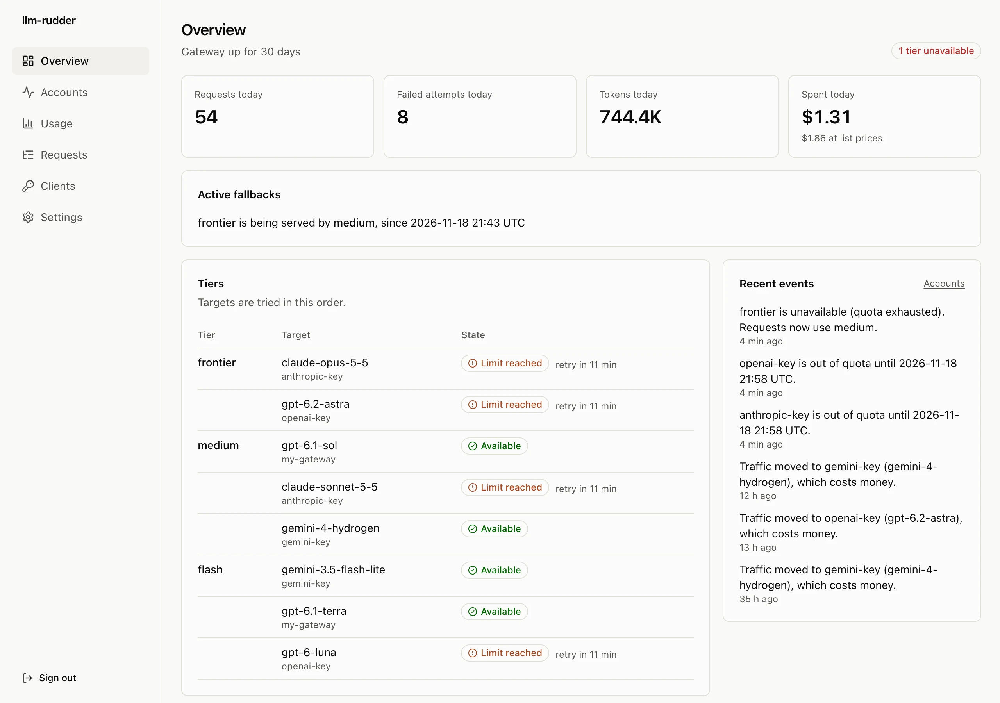
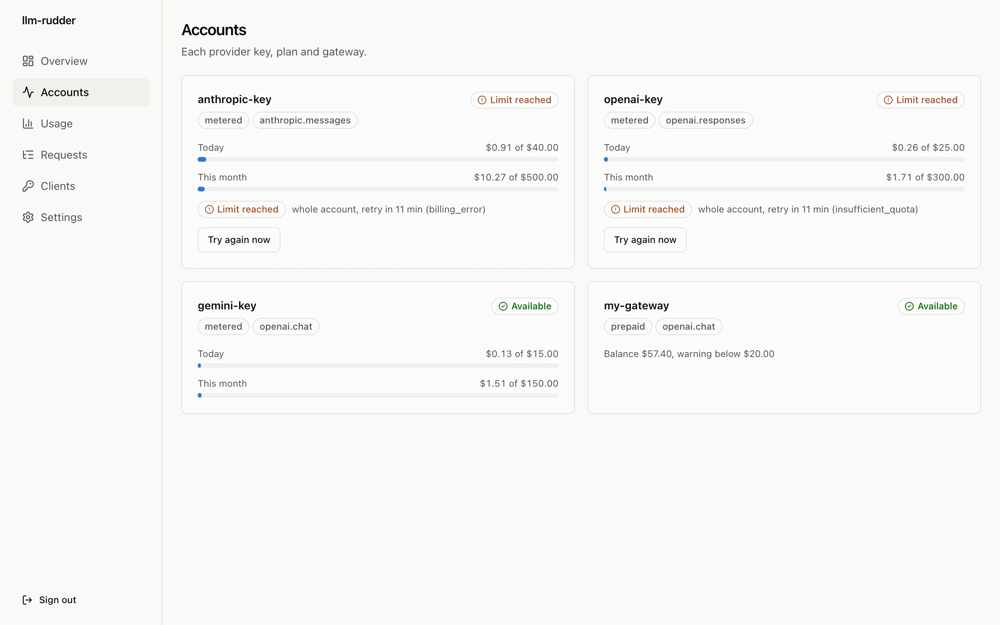
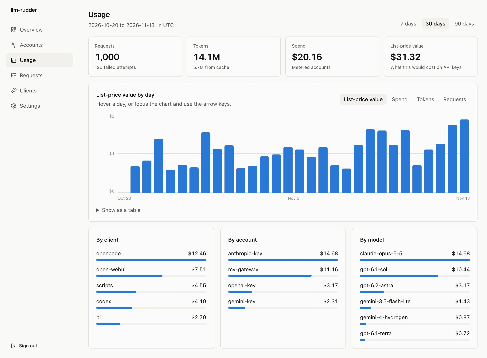
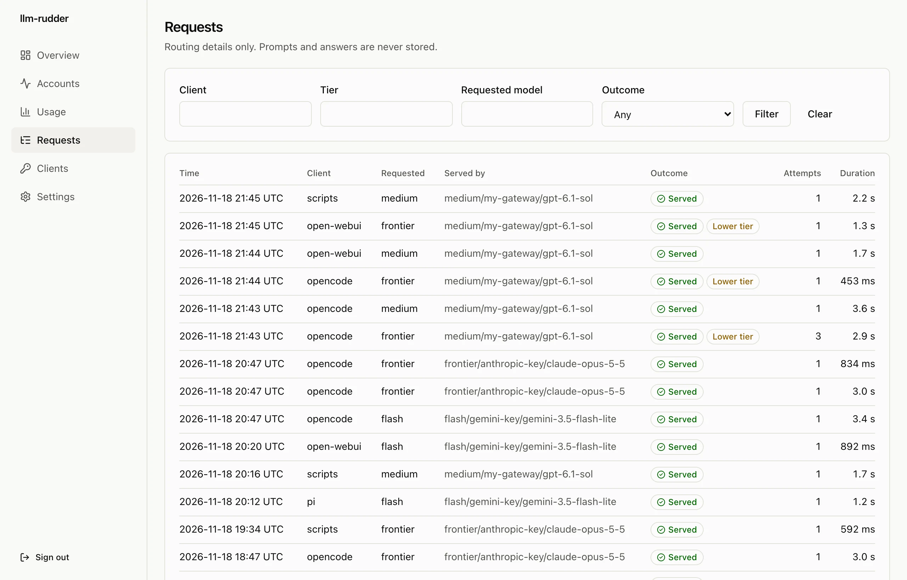
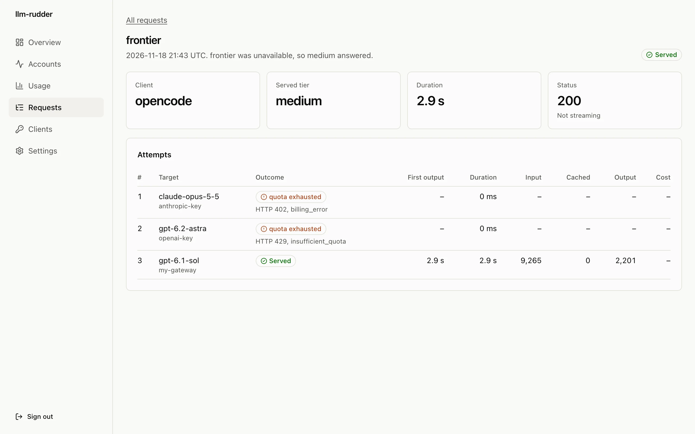
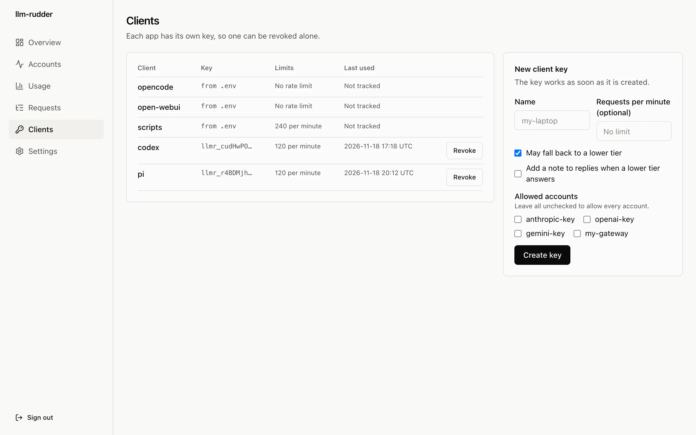
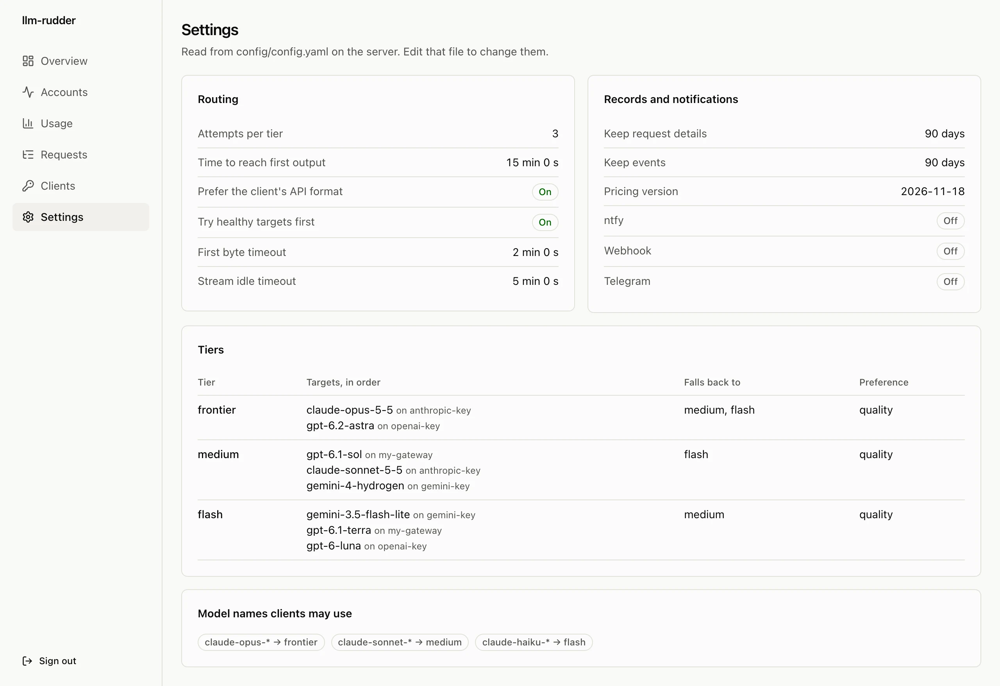

# User guide

This guide explains how llm-rudder behaves and how to use it day to day. To install it on a server, follow the [deployment guide](DEPLOYMENT.md). To try it without any accounts, see [the demos](../README.md#see-it-in-two-minutes).

- [How it works](#how-it-works)
- [Set up your accounts](#set-up-your-accounts)
- [Connect your apps](#connect-your-apps)
- [Use the dashboard](#use-the-dashboard)
- [When something looks wrong](#when-something-looks-wrong)

## How it works

Three words cover most of it:

- A **tier** is a quality level that apps ask for. The defaults are `frontier`, `medium` and `flash`.
- An **account** is something that can serve models: an API key, a plan or another gateway.
- A **target** is one model on one account. Each tier is an ordered list of targets.

```yaml
tiers:
  frontier:
    fallback_tiers: [medium, flash] # used when no frontier target can answer
    targets:
      - { account: chatgpt-plan, model: gpt-6.2-astra, effort: high }
      - { account: anthropic-key, model: claude-opus-5-5 }
      - { account: my-gateway, model: claude-opus-5-5 }
```

A request for `frontier` tries those targets in order. If they all fail or are paused, it moves to `medium`, then `flash`. An app can also name an exact model that appears in your tiers.

### What happens when something fails

| What happens                             | What llm-rudder does                                                                                                       |
| ---------------------------------------- | -------------------------------------------------------------------------------------------------------------------------- |
| A target returns an error or times out   | Tries the next target and rests that model briefly                                                                         |
| You hit a rate limit                     | Rests that model or account for a short time, using the provider's `retry-after` when it gives one                         |
| An account runs out of quota             | Pauses it until its reset time. With no reset time, it checks again after 15 minutes, then less often, up to every 4 hours |
| A key is refused                         | Stops the account until you replace the key and restart, or choose **Try again now**                                       |
| An account reaches its budget            | Skips it until the budget period resets                                                                                    |
| Every target in a tier is unavailable    | Uses the next tier and warns you                                                                                           |
| A stream breaks after output has started | Ends the reply with an error. It never joins output from two models                                                        |

A conversation stays on the target that is serving it, so a long task does not bounce between models. It returns to the tier it asked for once that tier has recovered.

### How you find out

- **In the reply.** Apps set to `notice: text` get a short note when a lower tier answers.
- **In the response headers.** Scripts can read them, as described [below](#any-openai-compatible-app).
- **In the dashboard.** The Overview page lists active fallbacks and recent events.
- **As a notification.** [Alerts](DEPLOYMENT.md#11-get-alerts) can go to ntfy, Telegram or a webhook.

## Set up your accounts

Accounts live in `config/config.yaml`, and their keys live in `.env`. After you edit them, run `docker compose up -d gateway`.

### An API key

```yaml
accounts:
  openai-key:
    api: openai.responses
    base_url: https://api.openai.com/v1
    api_key_env: OPENAI_API_KEY # the name of the value in .env
    compat: openai
    cost_class: metered
    trust: first_party
    budget: { daily_usd: 5, monthly_usd: 50 }
```

| Setting      | Meaning                                                                                  |
| ------------ | ---------------------------------------------------------------------------------------- |
| `api`        | The format the service speaks: `openai.chat`, `openai.responses` or `anthropic.messages` |
| `compat`     | Known differences to allow for: `openai`, `gemini`, `new_api`, `openrouter` or `generic` |
| `cost_class` | `metered` costs money per request. `prepaid` and `free` do not count toward budgets      |
| `trust`      | `first_party`, `self_hosted` or `third_party`. It records who can see your prompts       |
| `budget`     | The most this account may spend, per day or per month                                    |

[`config/config.example.yaml`](../config/config.example.yaml) has ready-made entries for OpenAI, Anthropic and Gemini.

### Any compatible gateway or provider

Anything with an OpenAI-compatible or Anthropic-compatible API can be an account, including another gateway such as New API, One API, LiteLLM or sub2api.

```yaml
accounts:
  my-gateway:
    api: openai.responses # or openai.chat, or anthropic.messages
    base_url: https://gateway.example.com/v1
    api_key_env: MY_GATEWAY_API_KEY
    compat: new_api # leave this out for other gateways
    cost_class: prepaid
    trust: third_party
```

Then list its models under the tiers that should use it. A gateway passes on errors from its own channels, so llm-rudder checks with the gateway before it stops using the whole account. The [deployment guide](DEPLOYMENT.md#add-a-gateway-or-another-provider) explains how to run one gateway behind another.

### Use your ChatGPT plan

An eligible ChatGPT Plus or Pro plan can serve every client, through OpenAI's [Sign in with ChatGPT](https://developers.openai.com/siwc/token-sharing-open-source) for open-source apps. Sign-in, moving it to a VPS, renewing it there, the plan's model list, streaming, and a tool call with its follow-up have been tested against a real plan.

Before you turn it on:

- **Use a public, open-source copy of this project.** OpenAI's guide covers open-source and locally hosted apps, and asks paid or hosted services to apply separately.
- **Keep it to yourself.** OpenAI's guide does not cover a server that forwards other people's requests. Do not give anyone else a key that can reach this account. A client's `allow_accounts` setting limits which accounts its key can use.

In `config/config.yaml`, set `enabled: true` under `chatgpt-plan`, check that the models in your tiers are on your plan, and restart with `docker compose up -d gateway`. Then, on your own computer, with `llmr-edge` installed as described in [Use it with Claude Code](#use-it-with-claude-code):

```bash
llmr-edge chatgpt login                # Continue with ChatGPT in your browser
llmr-edge chatgpt push root@your-vps   # move the sign-in to the VPS over SSH
llmr-edge chatgpt status --for root@your-vps
```

These commands assume the project is in `/opt/llm-rudder`. Use `--dir` if it is elsewhere. After the push, the VPS keeps the sign-in renewed and your computer no longer holds its tokens. The gateway picks up the new sign-in within a few seconds.

**Set a limit for this app.** In [ChatGPT settings, under Usage](https://chatgpt.com/settings/usage), you can cap this app at 10% to 100% of your weekly usage and choose whether it may use credits. On Plus, the five-hour limit is shared with every other app you use with ChatGPT.

**When the plan reaches a limit,** OpenAI gives no reset time. The gateway moves on to the next target, leaves the plan alone for 15 minutes, and then lets one request check it, doubling the wait up to 4 hours while it stays out. You get a notification with a link to your usage settings.

**If you are told to sign in again,** run `llmr-edge chatgpt login --for root@your-vps`. To stop using the plan, run `llmr-edge chatgpt logout --for root@your-vps`. If you think the sign-in was exposed, also disconnect the app in ChatGPT settings.

The plan route does not accept `max_tokens`, `temperature` or `top_p`, so the gateway leaves them out. Requests that need stored conversation state, files uploaded by ID, or hosted tools other than web search go to another target.

### Check your accounts

This command confirms that each service accepts its key and offers the models your tiers name. With `--live`, it also sends each model a short question and a tool call, through the same code as real traffic. That uses a small number of tokens.

```bash
docker compose exec gateway node dist/cli.js check-accounts --live
```

```text
my-gateway (openai.responses, gateway.example.com)
  ok   the service answered and lists 42 models
  ok   no spending limit is reported for this key
  ok   frontier/gpt-6-astra: listed, reply in 1.7s, tool call in 2.1s
  FAIL medium/gpt-old: the service does not list this model
```

Add account names to check only those. The command exits with an error if any check fails, so scripts can use it too.

## Connect your apps

Give each app its own key, so you can limit or revoke it separately. The [deployment guide](DEPLOYMENT.md#6-connect-your-clients) lists the keys created during setup, and the dashboard can create more.

### Any OpenAI-compatible app

Set the base URL to your gateway's address followed by `/v1`, and use a tier as the model.

```bash
curl https://llm.example.com/v1/chat/completions \
  -H "Authorization: Bearer $LLMR_KEY_SCRIPTS" \
  -H "Content-Type: application/json" \
  -d '{"model":"frontier","messages":[{"role":"user","content":"Hello"}]}' -i
```

The response headers show what happened:

| Header                                        | Meaning                                                        |
| --------------------------------------------- | -------------------------------------------------------------- |
| `x-llmr-target`                               | The tier, account and model that answered                      |
| `x-llmr-requested-tier`, `x-llmr-served-tier` | What you asked for and what served it                          |
| `x-llmr-fallback`                             | Targets that were skipped or failed, and why                   |
| `x-llmr-tier-fallback`                        | Present when another tier answered, such as `frontier->medium` |

Ready-made settings for [OpenCode](DESIGN.md#opencode-phase-1), [Pi](DESIGN.md#pi-phase-1), [Open WebUI](DESIGN.md#open-webui-phase-1), [LibreChat](DESIGN.md#librechat-phase-1) and the [OpenAI SDK](DESIGN.md#openai-sdk-phase-1) are in the design document.

### Use it with Claude Code

Claude Code talks to `llmr-edge`, a small program on your own computer. The edge sends requests to Anthropic with your normal login. Only when your plan reports a limit does it send the request to your gateway, with the Claude login removed, so the login never reaches the VPS.

```bash
pnpm install && pnpm --filter @llm-rudder/edge build
node apps/edge/dist/llmr-edge.mjs install
LLMR_ROUTER_KEY="$LLMR_KEY_CLAUDE_CODE" llmr-edge setup --gateway https://llm.example.com
llmr-edge service install
llmr-edge doctor
```

`setup` prints the settings to add to `~/.claude/settings.json`. Do not set `ANTHROPIC_AUTH_TOKEN`, `ANTHROPIC_API_KEY` or `apiKeyHelper`, because each one replaces your plan login. On the gateway, add an `anthropic-key` account and the `edge` section from [`config/config.example.yaml`](../config/config.example.yaml).

> Anthropic says developers may not "intermediate" Claude login tokens, and its docs do not address a personal helper like this one. The token stays on your computer and goes only to Anthropic, but some risk remains. See [the design](DESIGN.md#31-claude-plan). To stop using the edge, remove those settings.

### Use it with Codex

Add this to `~/.codex/config.toml`, replacing the hostname:

```toml
[model_providers.llmr]
name = "llm-rudder"
base_url = "https://llm.example.com/v1"
model_catalog_url = "https://llm.example.com/router/codex/models"
wire_api = "responses"
env_key = "LLMR_KEY_CODEX"
requires_openai_auth = false
```

Create `~/.codex/llmr.config.toml`:

```toml
model_provider = "llmr"
model = "frontier"
web_search = "disabled"
```

Then run `codex --profile llmr`.

## Use the dashboard

Start it by following [Add the dashboard](DEPLOYMENT.md#10-add-the-dashboard). It stays off the public internet unless you choose otherwise. The pictures here use made-up demo data, and they follow your light or dark setting.

### Overview

<picture>
  <source media="(prefers-color-scheme: dark)" srcset="images/overview-dark.webp">
  
</picture>

Start here to see whether everything is working. The top row shows today's requests, failed attempts, tokens and spending. **Active fallbacks** lists tiers being served by another tier, **Tiers** shows the state of every target, and **Recent events** shows what changed. The page refreshes by itself.

### Accounts

<picture>
  <source media="(prefers-color-scheme: dark)" srcset="images/accounts-dark.webp">
  
</picture>

Each card shows the account's state, its budgets and, for services that report one, its balance.

| State          | Meaning                                                          |
| -------------- | ---------------------------------------------------------------- |
| Available      | Ready to use                                                     |
| Cooling down   | Resting briefly after errors or a rate limit                     |
| Limit reached  | Out of quota, with no known reset time. It will be checked again |
| Out of quota   | Paused until a known reset time                                  |
| Rechecking     | One request is testing whether it has recovered                  |
| Stopped        | Its key was refused, so it needs your attention                  |
| Sign-in needed | The ChatGPT plan must be signed in again                         |

**Try again now** clears a pause. Use it after you add credit or fix a problem.

### Usage

<picture>
  <source media="(prefers-color-scheme: dark)" srcset="images/usage-dark.webp">
  
</picture>

Choose 7, 30 or 90 days, then view list-price value, spending, tokens or requests. **Spend** counts only metered accounts. **List-price value** shows what the same tokens would cost on API keys, which helps you see what your plans are worth.

### Requests

<picture>
  <source media="(prefers-color-scheme: dark)" srcset="images/requests-dark.webp">
  
</picture>

This is the record of every routing decision. Filter by client, tier, model or outcome. **Lower tier** marks requests answered by a tier other than the one requested. Prompts and answers are never stored.

### Request details

<picture>
  <source media="(prefers-color-scheme: dark)" srcset="images/request-detail-dark.webp">
  
</picture>

Open a request to see each target it tried, in order, with the error, timing, tokens and cost of each attempt.

### Clients

<picture>
  <source media="(prefers-color-scheme: dark)" srcset="images/clients-dark.webp">
  
</picture>

Create a key for each app, with an optional rate limit and a list of accounts it may use. A new key is shown once, so copy it right away. Keys created here can be revoked here. Keys from `.env` are changed on the server.

### Settings

<picture>
  <source media="(prefers-color-scheme: dark)" srcset="images/settings-dark.webp">
  
</picture>

This page shows the configuration in use. To change it, edit `config/config.yaml` on the server, then choose **Reload config** or run `docker compose kill -s HUP gateway`.

## When something looks wrong

| What you see                                          | What it means and what to do                                                                                               |
| ----------------------------------------------------- | -------------------------------------------------------------------------------------------------------------------------- |
| A reply says a lower tier answered                    | The requested tier is out. Open **Accounts** to see why. It returns by itself when an account recovers                     |
| An account says **Stopped**                           | Its key was refused. Put a working key in `.env` and run `docker compose up -d gateway`                                    |
| An account says **Limit reached** after you topped up | Choose **Try again now**                                                                                                   |
| `No target could serve this request`                  | Read the `x-llmr-fallback` header, then run `check-accounts --live`                                                        |
| `All targets for this request are out of quota`       | Everything is paused. The `retry-after` header says when one can be tried                                                  |
| HTTP `401`                                            | The app's key is missing or wrong                                                                                          |
| A model is never used                                 | It may be missing from the service. `check-accounts` reports this. The model catalog may also rule it out for that request |
| Answers arrive all at once                            | Turn off response buffering in your proxy                                                                                  |

The [deployment guide](DEPLOYMENT.md#9-troubleshooting) covers problems with the server itself.
